# Huawei AH100 for Home Assistant

[English](README.md) | [Français](docs/README.fr.md) | [Deutsch](docs/README.de.md)

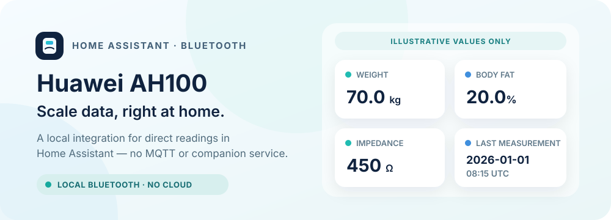

An unofficial, local Bluetooth integration for reading body-composition measurements from the Huawei AH100 smart scale in Home Assistant.

[](https://github.com/frankbrg/huawei-ah100/actions/workflows/validate.yaml)
[](https://github.com/frankbrg/huawei-ah100/releases)
[](LICENSE)

[](https://my.home-assistant.io/redirect/hacs_repository/?owner=frankbrg&repository=huawei-ah100&category=integration)
[](https://my.home-assistant.io/redirect/config_flow_start/?domain=huawei_ah100)

> **Validation status:** The existing manual Home Assistant profile flow has received a real scale reading. The new profile-confirmation and household-automation flow and SparkyFitness export have not yet been validated end to end against the hardware.

## What it provides

Each configured scale has one physical device in Home Assistant. You can add a named profile for each person who uses it. The profile of a weighing comes from a direct selection, a profile confirmation, a nearby phone, or, when none of these applies, from the weight itself; see [Profile assignment](#profile-assignment). If a weighing is already underway, let it finish before switching profiles; Home Assistant keeps that result with the profile chosen when the session began.

Each profile has its own logical device linked to the physical scale and its own four measurement sensors:

| Entity | Unit | Meaning |
| --- | --- | --- |
| Weight | kg | Live weight reading |
| Body fat | % | Body-fat value reported by the scale |
| Impedance | Ω | Electrical impedance reported by the scale |
| Last measurement | UTC | When Home Assistant received the latest valid live record |

The physical scale device also has a **Profile for next weighing** selector and an **Assigned profile** sensor. Each profile device includes a **SparkyFitness sync** diagnostic sensor. It shows `disabled` when sync is off, `pending` before a sync is confirmed or while data waits, `synced` after success, and `error` after a failed attempt.

Measurement attributes include `user_id`, the device-local timestamp (`device_measured_at`), the device weekday field (`weekday`), and uninterpreted trailing bytes (`unknown_tail_hex`). Unknown bytes stay explicitly unknown; they are not labelled as visceral fat or another body metric. The integration does not calculate water, muscle, bone, BMI, BMR, or other derived values.

The initial weight is only a hint used when synchronizing a profile to the scale; it is not a measurement and is never published as a sensor reading. After a live measurement, that actual reading can be used as the next profile hint.

## Requirements and status

- Home Assistant **2026.10.0 or newer**.
- A supported Huawei AH100/CH100 scale and Bluetooth adapter available to Home Assistant.
- Keep Huawei Health disconnected from the scale during setup and measurements. The scale accepts one active Bluetooth central connection at a time.

Initial setup asks Home Assistant's Bluetooth stack to actively scan for nearby, connectable CH100 scales and offers a chooser when it finds one. After setup, Home Assistant's Bluetooth discovery detects the scale waking up. Bluetooth proxies have not been verified. The integration does not require MQTT, Docker, a companion service, or a cloud account.

This is an independent community project and is not affiliated with Huawei. The integration version is **0.3.0**. The request to add the repository to the HACS default catalog is [open and awaiting maintainer review](https://github.com/hacs/default/pull/12666); until it is accepted, add it as a custom repository using the button above.

## Installation

### HACS

1. Install [HACS](https://hacs.xyz/docs/use/) if it is not already available in Home Assistant.
2. Select the HACS button above. If prompted, add `frankbrg/huawei-ah100` as a custom repository with category **Integration**.
3. Download the integration and restart Home Assistant.
4. Select the **Add integration** button above, or open **Settings → Devices & services → Add integration** and search for **Huawei AH100**. Home Assistant starts a nearby search.

### Manual

1. Copy `custom_components/huawei_ah100` from this repository into `<config>/custom_components/huawei_ah100` in your Home Assistant configuration directory.
2. Restart Home Assistant.
3. Add **Huawei AH100** from **Settings → Devices & services**.

## Set up the scale and first profile

Close Huawei Health on nearby phones, bring Home Assistant within Bluetooth range, and briefly step on the scale to wake it. In the nearby-device chooser, select the connectable CH100 scale. If Home Assistant has already discovered the scale and shows an integration card, select **Configure**; that flow does not ask for a MAC address.

If the nearby search finds no scale, wake it again and choose **Retry search**, or choose **Manual setup** and enter its Bluetooth MAC address. Some passive-only adapters can hear advertisements but cannot retrieve the advertised name needed by the first-time chooser; use manual setup in that case. Once configured, passive scanning is sufficient to detect the scale waking up.

The first setup form creates the first named profile and sets the shared connection options. Enter:

- **Profile name:** a name that identifies whose readings these are.
- **Birth date:** the profile user's actual date of birth, entered in the browser's date field. You can type day, month and year in your browser's date format, or open the picker to choose month and year.
- **Height:** the profile user's height in whole centimeters.
- **Sex:** the profile value for the person who will use the scale.
- **Initial weight hint:** a starting value for the scale profile. It is not a measurement or sensor reading.
- **Home Assistant person (optional):** a person entity linked as read-only profile metadata. It does not select the active profile or authenticate the person.
- **SparkyFitness sync (optional):** leave off unless you want this profile's new measurements sent to SparkyFitness; see [SparkyFitness sync](#sparkyfitness-sync).
- **Scale user ID:** the scale's authentication slot, default `1`. It is shared by all profiles; leave it at `1` unless you know a different slot is required.
- **Allow pairing or binding:** a shared connection option. Enable it if this adapter has not been authorized by the scale and binding is needed. Binding can change the existing association; leave it off if the adapter is already authorized.

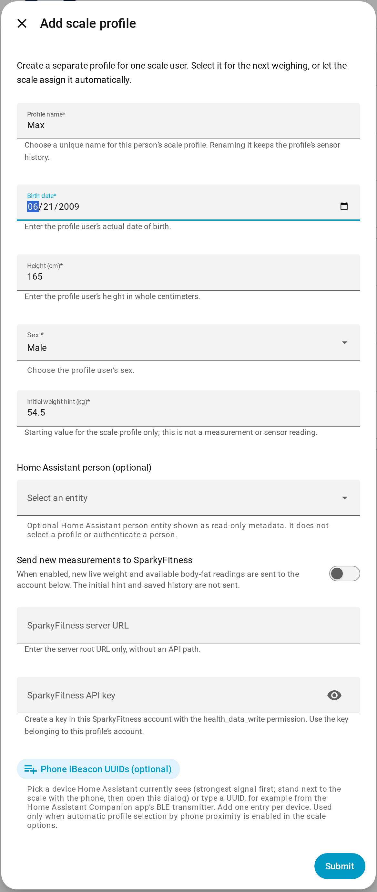

*The profile fields as shown by **Add profile**. The first setup form has the same fields plus the MAC address and the connection options. The birth date uses your browser's date format.*

Submit the form once. Close Huawei Health, step onto the scale barefoot, and stand still until the weighing finishes. Sensors receive values only after Home Assistant gets an actual measurement; the initial weight hint does not populate them.

## Add and select profiles

Open the Huawei AH100 integration page in **Settings → Devices & services** and select **Add profile** to create another profile. Edit or rename a profile from that same page. Profile names must be unique. Renaming a profile keeps its sensor identities and history.

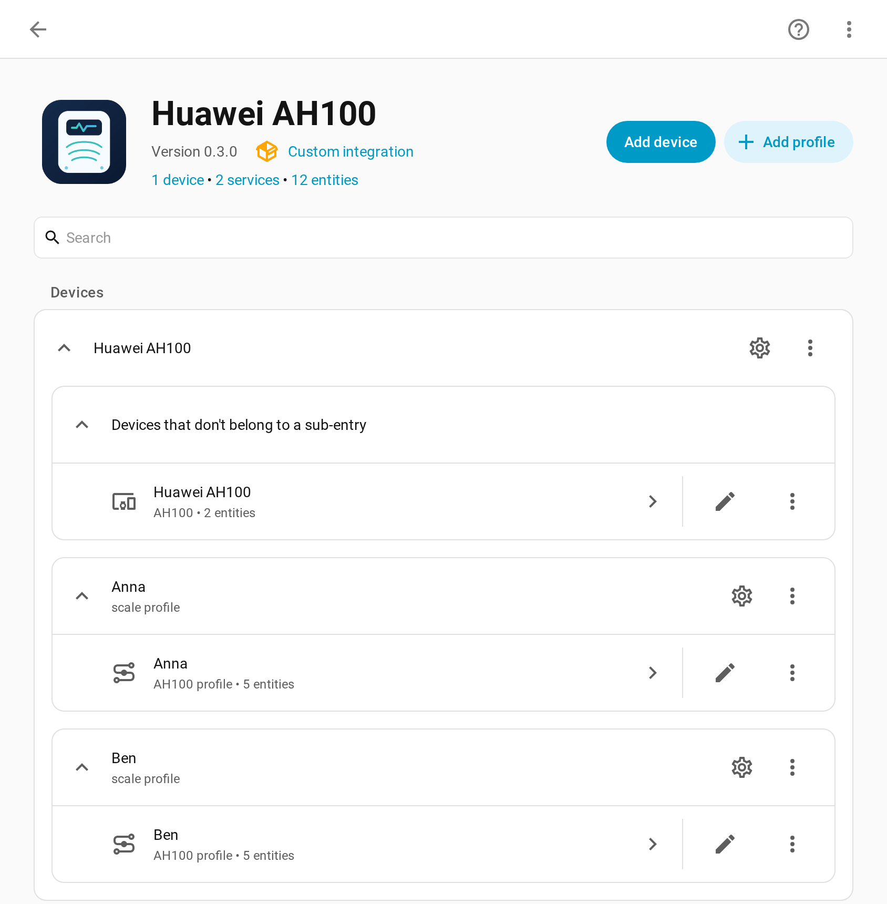

*The integration page: one scale device and one device per profile. **Add profile** creates another profile; the gear icon of a profile edits it.*

Each profile has separate measurements and its own device in Home Assistant, linked to the physical scale. If you upgrade from the previous single-profile setup, it becomes **Profile 1** and keeps its existing sensor IDs, readings, and history.

The scale's **Scale user ID**, **Allow pairing or binding**, and optional **Require profile confirmation for each weighing** settings are shared by every profile and live in the integration's connection options. The user ID is the scale's authentication slot, not the profile ID. Selecting a profile does not change this setting or rebind the scale. If a weighing session is already running, Home Assistant lets it finish and associates the result with the original profile before the next session uses the newly selected profile.

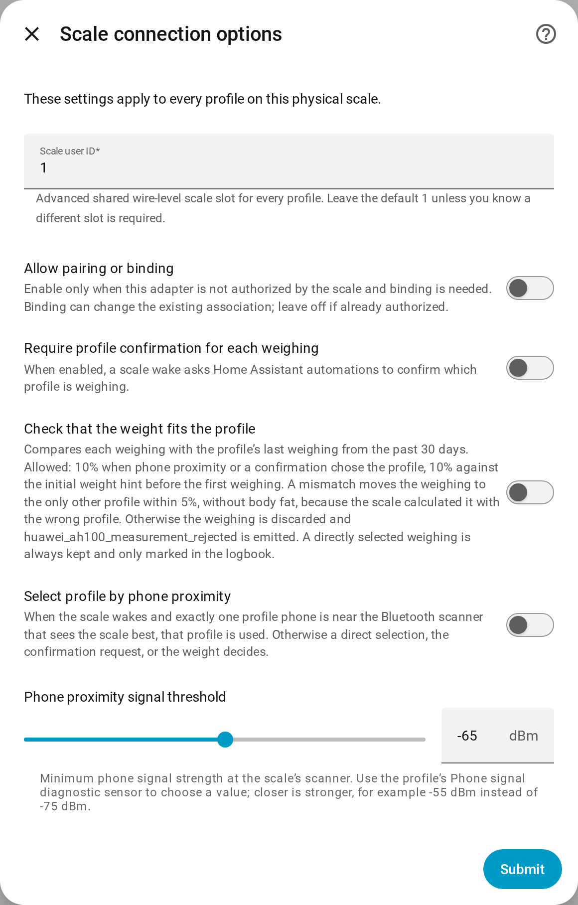

*The scale's connection options, opened with the gear icon of the scale.*

## Profile assignment

The integration decides the profile of each weighing in this order:

1. **Direct selection:** pick the person in the scale's **Profile for next weighing** selector. The selection applies to the next saved weighing only; afterwards the selector returns to **Automatic**. A selection is not kept across restarts.
2. **Profile confirmation**, if enabled (see below).
3. **Phone proximity**, if enabled (see [Automatic profile selection by phone proximity](#automatic-profile-selection-by-phone-proximity)).
4. **Weight:** with **Automatic** and no nearby phone, the weighing goes to the only profile whose last weighing, or initial weight hint before the first weighing, is within 5% (10% for the hint). If two or more profiles fit, or none, the weighing is discarded and `huawei_ah100_measurement_rejected` is emitted with `reason` `ambiguous_weight` or `no_matching_profile` and the fitting profiles in `candidates`. The scale computes body fat with the profile it was set up for, which is the last weighed person, so body fat is dropped when the weighing goes to someone else. With only one profile, every weighing goes to it.

Every activation and deactivation is logged. The **Assigned profile** sensor shows the profile that is active for the next weighing, or **Automatic**, with the attributes `method` (`selection`, `confirmation`, or `proximity`) and `activated_at`; its history shows when each profile was active. In addition, `huawei_ah100_profile_activated` and `huawei_ah100_profile_deactivated` events carry `entry_id`, `profile_id`, `profile_name`, `method`, optional `person_entity_id`, and for deactivation a `reason`: `weighing_saved`, `replaced`, `deselected`, `out_of_range`, `multiple_phones_nearby`, or the cancellation reason of a confirmation. The logbook lists these events together with saved weighings and how they were assigned (`assigned_by` in `huawei_ah100_measurement_saved`), and discarded weighings with their reason.

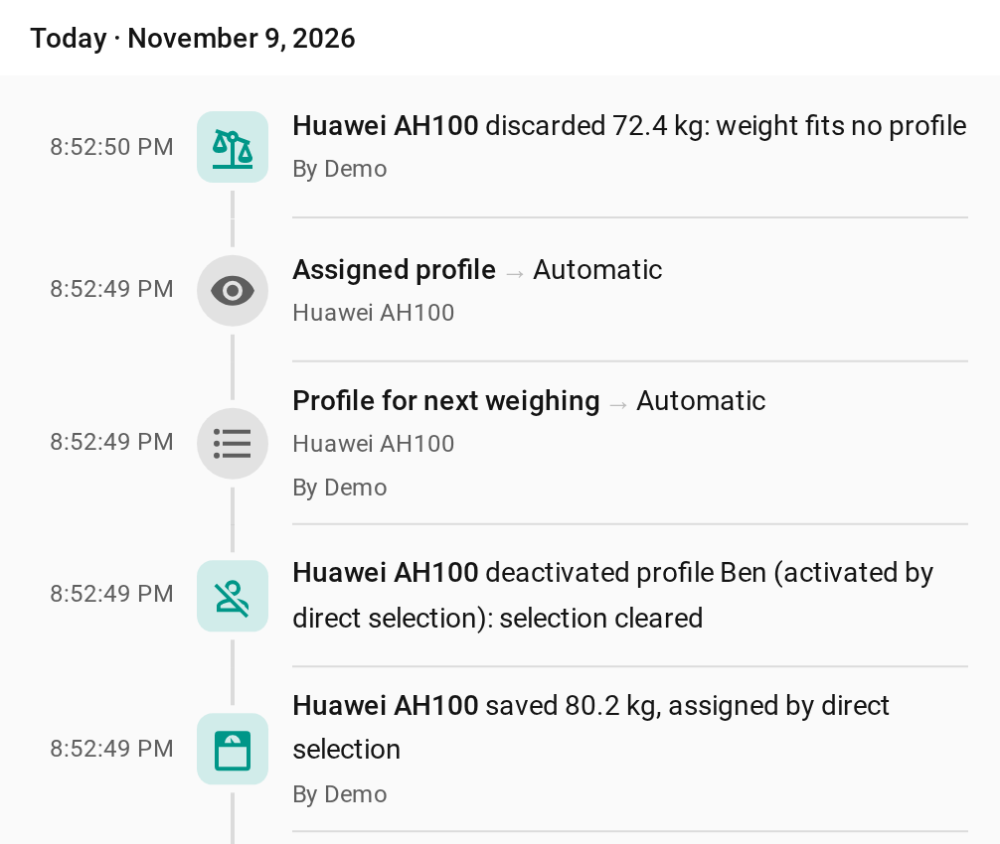

*Logbook entries: a profile selected directly, the weighing saved for it, the selection ending, and a weighing that fit no profile.*

## Optional household automations

Without this option, the profile comes from the selector, a nearby phone, or the weight. To ask Home Assistant automations to confirm the profile for each weighing, enable **Require profile confirmation for each weighing** in the scale's integration options. Initial setup does not show this option.

When enabled, a scale wake emits `huawei_ah100_weighing_requested` with the scale `entry_id`, a `request_id`, an expiry time in `expires_at`, and the configured profiles (`profile_id`, `name`, and optional `person_entity_id`). The integration does not decide who is home or send notifications; create Home Assistant automations for your household. They can claim automatically when household logic identifies exactly one eligible resident, or send actionable notifications when several residents may be weighing. For an actionable notification, pass the original event's `trigger.event.context.user_id` as `claimant_user_id`; use that event context rather than an identity value supplied in notification action data.

An automation confirms a profile with `huawei_ah100.claim_weighing`, passing the event's `entry_id` and `request_id` plus the chosen `profile_id`. The optional `claimant_user_id` field is for the authenticated Home Assistant user who tapped an actionable notification; leave it empty for trusted automatic selection. The first valid claim wins. A request is rejected after it expires or the scale sleeps, disconnects, or Home Assistant reloads. Once claimed, the profile stays fixed for that measurement because the scale uses its demographic details when calculating body-fat readings. If the scale has already gone back to sleep, wake it again, claim the new request, then weigh.

The integration emits `huawei_ah100_profile_confirmed` after accepting a claim and `huawei_ah100_weighing_cancelled` when a request ends without a measurement; the latter includes a `reason`. When a measurement is durably saved locally, `huawei_ah100_measurement_saved` fires with its `measurement_id`, which can drive an immediate local acknowledgement such as a green blink. `huawei_ah100_measurement_completed` fires for that same durable measurement after SparkyFitness succeeds or when sync is disabled, with `sync_status` set to `synced` or `disabled`. Use the completed event for a final result notification to the owner. For event fields and the request lifecycle, see [Protocol notes](docs/protocol.md).

## Automatic profile selection by phone proximity

If each household member carries a phone that broadcasts an iBeacon, the scale can pick the profile on its own. The Home Assistant Companion app for Android can do this with its **BLE transmitter** sensor; any other iBeacon source works as well. The phone's Bluetooth address may change, so the integration identifies phones by their iBeacon UUID only.

1. On each phone, turn on the iBeacon transmitter.
2. Stand next to the scale with the phone, edit the profile, and pick the device in **Phone iBeacon UUIDs**. The list shows the iBeacons Home Assistant currently sees, strongest signal first, with the scanner that receives them. It is filled when the dialog opens, so reopen it to refresh. You can also type a UUID, one entry per device. A profile can have several UUIDs, for example a phone and a tag, but each UUID can belong to only one profile.
3. Enable the profile's **Phone signal** diagnostic sensor. It is disabled by default. It shows the strongest signal of that profile's devices at the Bluetooth scanner that receives the scale best, for example an ESPHome Bluetooth proxy in the bathroom. Readings older than 10 seconds are ignored.
4. Stand at the scale with the phone where you usually carry it, and note the value. Then note the value from where other people usually are, for example the next room.
5. In the scale's integration options, enable **Select profile by phone proximity** and set **Phone proximity signal threshold** between those two values. The default is -65 dBm.

While exactly one profile phone is at or above the threshold at that scanner, that profile is activated, and a weighing uses it unless a profile was selected directly. The integration checks every 5 seconds and logs when the phone comes and goes. With **Require profile confirmation for each weighing**, the integration confirms the profile itself: it skips `huawei_ah100_weighing_requested` and emits `huawei_ah100_profile_confirmed` with `source: proximity`; a direct selection is confirmed the same way with `source: selection`. Several devices of the same profile count as one. When phones of two or more profiles are near at once, proximity does not choose: `huawei_ah100_multiple_phones_nearby` is emitted with `profile_ids` and `profile_names`, a profile activated by proximity is deactivated with the reason `multiple_phones_nearby`, and the weighing is assigned by weight. If that weighing is then discarded, `huawei_ah100_measurement_rejected` also lists those profiles in `nearby_profiles`. When no phone is near, the weighing is assigned by weight as well. Phone UUIDs and signal readings stay in Home Assistant and are never sent to SparkyFitness.

## Weight plausibility check

Enable **Check that the weight fits the profile** in the scale's integration options to catch weighings stored for the wrong person. This applies to weighings whose profile was confirmed or found by phone proximity; weighings assigned by weight are always checked as described in [Profile assignment](#profile-assignment). Each weighing is compared with the profile's last weighing from the past 30 days:

- up to 10% difference is accepted;
- before a profile's first weighing, its initial weight hint is used with 10%;
- if the last weighing is older than 30 days, the weighing is accepted without a check, so a long break or a diet does not lose data.

When a weighing does not fit, it moves to the only other profile within 5%. The scale calculated body fat with the wrong profile's height, age, and sex, so a moved weighing keeps weight and impedance but no body fat; `huawei_ah100_measurement_saved` then contains `redirected_from`. If no other profile or more than one fits, the weighing is discarded and `huawei_ah100_measurement_rejected` is emitted with `entry_id`, `profile_id`, `reason` `weight_mismatch`, `weight_kg`, `reference_weight_kg`, and `impedance_ohm`. The check cannot tell apart people whose weights are within 5% of each other.

A directly selected weighing is never moved or discarded, so a real weight change or a wrong earlier weighing cannot block a profile. If it fails the check, it is still saved and `huawei_ah100_measurement_saved` contains `weight_check_overridden: true`, which the logbook shows.

## SparkyFitness sync

SparkyFitness sync is optional and configured separately in each profile. To enable it:

1. Enable **SparkyFitness sync** in the profile form.
2. Enter the root URL of the server, such as `https://fitness.example.com`; do not append an API path.
3. Create an API key in the corresponding SparkyFitness account with the `health_data_write` permission and enter that account's key. Give each person's profile the key for their own account; do not reuse one shared account key across profiles.

When editing a profile later, leave the API-key field blank to keep its saved key; Home Assistant does not prefill it.

This integration sends only new live weighings: weight in kilograms and body-fat percentage when available. It does not send the initial weight hint, saved history, profile fields, or impedance. It sends a `POST` to `/api/measurements/health-data`, an endpoint present in [SparkyFitness v0.17.3](https://github.com/CodeWithCJ/SparkyFitness/blob/2a7e0d8f317fff14fc6596d573df0c2ae6ba6f9d/SparkyFitnessServer/routes/measurementRoutes.ts). SparkyFitness stores a daily check-in for each account; another weighing that day updates that day's values. The request contains a date without a time, using the Home Assistant local calendar day, so the SparkyFitness account timezone should match Home Assistant's timezone. The precise weighing time and impedance remain available in Home Assistant.

The **SparkyFitness sync** sensor reports `disabled`, `pending`, `synced`, or `error`. A configured profile may show `pending` before its first confirmed sync. If the server is unavailable, a measurement stays queued and sync retries later. Changing the URL or API key does not reassign a queued measurement to a different account. Setting up the integration does not create a test measurement or backfill old readings.

## Dashboard cards

The integration brings two dashboard cards. They load automatically; no resource entry or separate download is needed. Edit a dashboard, select **Add card**, and search for **Huawei AH100**. After an update, reload the browser page once.

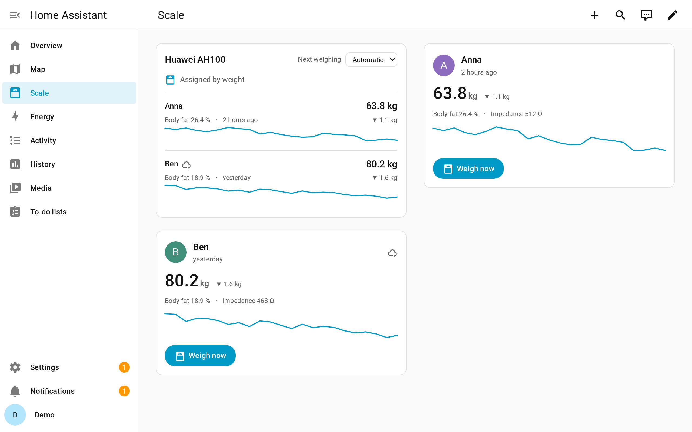

*Example dashboard with demo data: the scale card and a profile card for each person.*

- **Huawei AH100 scale** (`custom:huawei-ah100-card`): all profiles of a scale with their latest weight, body fat, time of the last weighing, SparkyFitness status, and a 30-day trend from the daily averages. A dropdown chooses the profile for the next weighing, a line shows which profile is active and how, and a discarded weighing from the past 24 hours is shown with its reason. Select a profile to open its weight history.
- **Huawei AH100 profile** (`custom:huawei-ah100-profile-card`): one profile with its person picture, weight, trend, body fat, and impedance, and a **Weigh now** button. The button selects this profile for the next weighing; the card then asks you to step on the scale and offers **Cancel**. When phone proximity or a confirmation has activated the profile, the card says so.

| Scale card | Profile selected | Weighing discarded |
| --- | --- | --- |
| 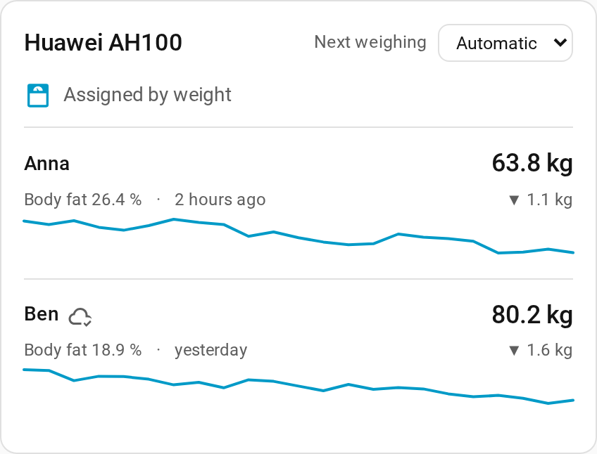 | 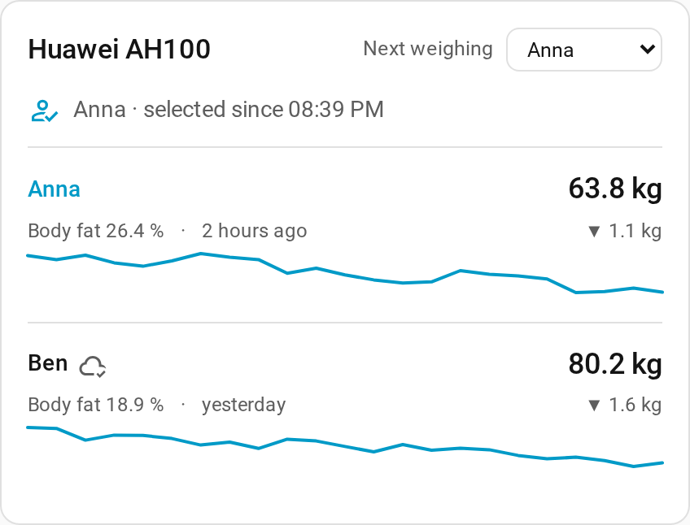 | 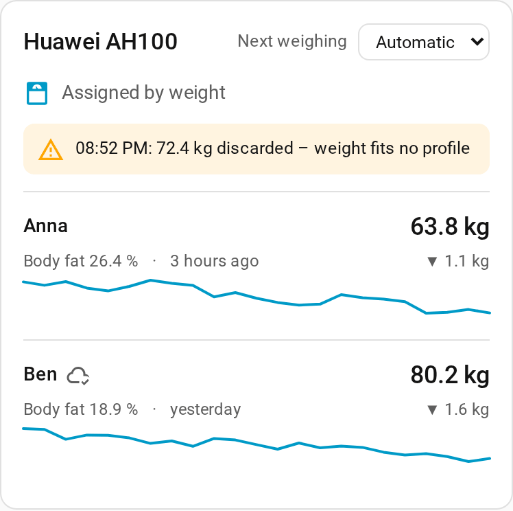 |

| Profile card | After **Weigh now** |
| --- | --- |
| 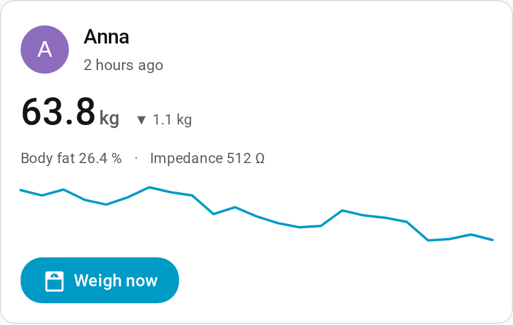 | 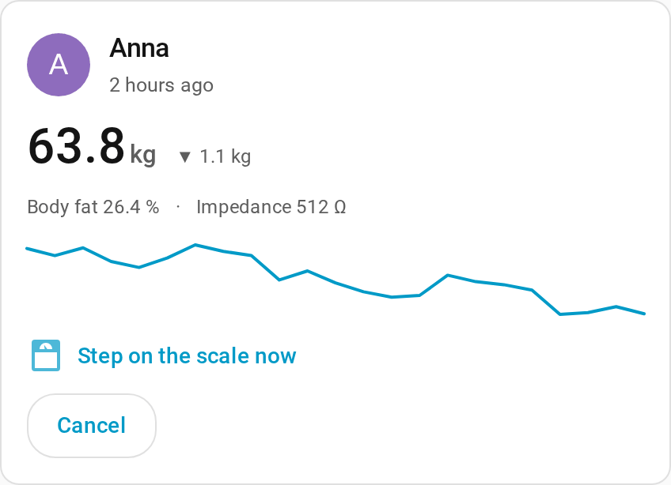 |

```yaml
type: custom:huawei-ah100-card
device_id: <scale device>
---
type: custom:huawei-ah100-profile-card
device_id: <profile device>
```

Both cards accept an optional `title`. They follow the dashboard theme and use English, German, or French depending on the Home Assistant language. The trend needs long-term statistics, so it appears after the first day with weighings.

## Troubleshooting

- **The nearby chooser is empty or has no scale name:** close Huawei Health, wake the scale, and retry within Bluetooth range. Check that Home Assistant's Bluetooth adapter is in **Automatic** or **Active** mode so the initial scan can retrieve the advertised name. If it is passive-only, use **Manual setup** and enter the MAC address.
- **Sensors are unavailable:** select the person in **Profile for next weighing**, then perform a barefoot weighing and stand still until the scale finishes. The sensors need a real reading before they have values.
- **Authentication is rejected:** if this adapter has not been authorized by the scale, enable **Allow pairing or binding** in the integration's connection options, then wake the scale again. Binding can change the existing association; enable it only when needed.
- **A phone is connected or Home Assistant cannot connect:** close Huawei Health and disconnect other phones or clients from the scale, then verify the selected or entered MAC address.
- **SparkyFitness sync stays pending or reports an error:** check server reachability, the profile's URL, and that its API key belongs to the right account and has `health_data_write` permission. Confirm that account and Home Assistant use the same timezone.

## Privacy and data handling

Bluetooth communication with the scale is local. No measurements or profile values go to a cloud service unless you enable SparkyFitness sync for a profile. When enabled, only new live weight, available body-fat percentage, and the Home Assistant local date are sent to that profile's configured SparkyFitness server. Birth date, height, sex, person entity, exact weighing time, and impedance are not sent to SparkyFitness.

The latest accepted live measurement is persisted in Home Assistant's private integration storage so entities can be restored and the actual weight can be reused as the next profile hint. The full decoded record is not published in sensor states or attributes; sensor attributes expose only the documented measurement metadata.

Do not include your scale MAC address, birth date, profile values, API keys, or unredacted Bluetooth captures in public issues. When reporting a problem, include the scale model and firmware and the Home Assistant version, with personal identifiers removed.

## Contributing

See [CONTRIBUTING.md](CONTRIBUTING.md) for the development setup, tests, and style checks. The protocol notes and validation limits are in [docs/protocol.md](docs/protocol.md).

## License and attribution

This project is licensed under **GPL-3.0-or-later**. The protocol implementation is a Kotlin-to-Python port based on openScale's [`HuaweiAhCh100Handler.kt`](https://github.com/oliexdev/openScale/blob/39a0c5c25a0abc26b8e24c90f36b5a2c6ff07a4a/android_app/app/src/main/java/com/health/openscale/core/bluetooth/scales/HuaweiAhCh100Handler.kt) at commit [`39a0c5c25a0abc26b8e24c90f36b5a2c6ff07a4a`](https://github.com/oliexdev/openScale/commit/39a0c5c25a0abc26b8e24c90f36b5a2c6ff07a4a). See [docs/protocol.md](docs/protocol.md) for protocol scope and attribution details.
