# Huawei AH100 für Home Assistant

[English](../README.md) | [Français](README.fr.md) | [Deutsch](README.de.md)

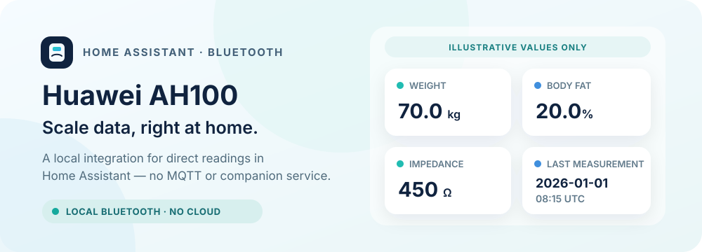

Eine inoffizielle, lokale Bluetooth-Integration, mit der Home Assistant die Körperzusammensetzungs-Messungen der intelligenten Waage Huawei AH100 ausliest.

[](https://github.com/frankbrg/huawei-ah100/actions/workflows/validate.yaml)
[](https://github.com/frankbrg/huawei-ah100/releases)
[](../LICENSE)

[](https://my.home-assistant.io/redirect/hacs_repository/?owner=frankbrg&repository=huawei-ah100&category=integration)
[](https://my.home-assistant.io/redirect/config_flow_start/?domain=huawei_ah100)

> **Validierungsstand:** Der bisherige manuelle Profilablauf in Home Assistant hat bereits eine echte Messung der Waage empfangen. Der neue Ablauf mit Profilbestätigung und Haushalts-Automationen sowie der Export zu SparkyFitness wurden noch nicht durchgängig mit der Hardware geprüft.

## Funktionsumfang

Jede eingerichtete Waage erscheint in Home Assistant als ein physisches Gerät. Für jede Person, die die Waage nutzt, kannst du ein benanntes Profil anlegen. Das Profil einer Wägung ergibt sich aus einer direkten Auswahl, einer Profilbestätigung, einem Handy in der Nähe oder, wenn nichts davon zutrifft, aus dem Gewicht selbst; siehe [Profilzuordnung](#profilzuordnung). Läuft bereits eine Wägung, lass sie zu Ende laufen, bevor du das Profil wechselst; Home Assistant ordnet dieses Ergebnis dem Profil zu, das beim Start der Sitzung gewählt war.

Jedes Profil hat ein eigenes logisches Gerät, das mit der physischen Waage verknüpft ist, und vier eigene Messsensoren:

| Entität | Einheit | Bedeutung |
| --- | --- | --- |
| Gewicht | kg | Live-Gewichtswert |
| Körperfett | % | Von der Waage gemeldeter Körperfettwert |
| Impedanz | Ω | Von der Waage gemeldete elektrische Impedanz |
| Letzte Messung | UTC | Zeitpunkt, zu dem Home Assistant den letzten gültigen Live-Datensatz empfangen hat |

Das physische Waagengerät hat außerdem eine Auswahl **Profil für nächste Wägung** und einen Sensor **Zugeordnetes Profil**. Jedes Profilgerät enthält einen Diagnosesensor **SparkyFitness-Synchronisierung**. Er zeigt `disabled`, wenn die Synchronisierung aus ist, `pending`, bevor eine Synchronisierung bestätigt ist oder solange Daten warten, `synced` nach erfolgreicher Übertragung und `error` nach einem fehlgeschlagenen Versuch.

Zu den Messattributen gehören `user_id`, der geräteinterne Zeitstempel (`device_measured_at`), das Wochentagsfeld des Geräts (`weekday`) und nicht interpretierte Bytes am Ende (`unknown_tail_hex`). Unbekannte Bytes bleiben ausdrücklich unbekannt; sie werden nicht als viszerales Fett oder als anderer Körperwert bezeichnet. Die Integration berechnet weder Wasser, Muskeln, Knochen, BMI, Grundumsatz noch andere abgeleitete Werte.

Das Startgewicht ist nur ein Hinweis, der beim Übertragen eines Profils an die Waage verwendet wird; es ist keine Messung und wird nie als Sensorwert veröffentlicht. Nach einer Live-Messung kann dieser tatsächliche Wert als nächster Profilhinweis dienen.

## Voraussetzungen und Status

- Home Assistant **2026.10.0 oder neuer**.
- Eine unterstützte Huawei-AH100/CH100-Waage und ein Bluetooth-Adapter, der Home Assistant zur Verfügung steht.
- Halte Huawei Health während der Einrichtung und der Messungen von der Waage getrennt. Die Waage akzeptiert jeweils nur eine aktive Bluetooth-Central-Verbindung.

Bei der Ersteinrichtung lässt die Integration den Bluetooth-Stack von Home Assistant aktiv nach verbindbaren CH100-Waagen in der Nähe suchen und bietet eine Auswahl an, wenn sie eine findet. Nach der Einrichtung erkennt die Bluetooth-Erkennung von Home Assistant, wenn die Waage aufwacht. Bluetooth-Proxys wurden nicht geprüft. Die Integration benötigt weder MQTT noch Docker, einen Begleitdienst oder ein Cloud-Konto.

Dies ist ein unabhängiges Community-Projekt und steht in keiner Verbindung zu Huawei. Die Version der Integration ist **0.3.0**. Der Antrag, das Repository in den HACS-Standardkatalog aufzunehmen, ist [offen und wartet auf die Prüfung durch die Maintainer](https://github.com/hacs/default/pull/12666); bis er angenommen ist, füge es über die Schaltfläche oben als benutzerdefiniertes Repository hinzu.

## Installation

### HACS

1. Installiere [HACS](https://hacs.xyz/docs/use/), falls es in Home Assistant noch nicht vorhanden ist.
2. Wähle die HACS-Schaltfläche oben. Füge bei Nachfrage `frankbrg/huawei-ah100` als benutzerdefiniertes Repository mit der Kategorie **Integration** hinzu.
3. Lade die Integration herunter und starte Home Assistant neu.
4. Wähle oben die Schaltfläche **Integration hinzufügen**, oder öffne **Einstellungen → Geräte & Dienste → Integration hinzufügen** und suche nach **Huawei AH100**. Home Assistant startet eine Suche in der Nähe.

### Manuell

1. Kopiere `custom_components/huawei_ah100` aus diesem Repository nach `<config>/custom_components/huawei_ah100` in deinem Home-Assistant-Konfigurationsverzeichnis.
2. Starte Home Assistant neu.
3. Füge **Huawei AH100** unter **Einstellungen → Geräte & Dienste** hinzu.

## Waage und erstes Profil einrichten

Schließe Huawei Health auf Handys in der Nähe, sorge dafür, dass Home Assistant in Bluetooth-Reichweite ist, und stell dich kurz auf die Waage, um sie aufzuwecken. Wähle in der Geräteauswahl die verbindbare CH100-Waage. Hat Home Assistant die Waage bereits erkannt und zeigt eine Integrationskarte an, wähle **Konfigurieren**; dieser Ablauf fragt nicht nach einer MAC-Adresse.

Findet die Suche keine Waage, wecke sie erneut und wähle **Erneut suchen**, oder wähle **Manuelle Einrichtung** und gib ihre Bluetooth-MAC-Adresse ein. Manche Adapter, die nur passiv scannen, empfangen zwar Advertisements, können aber den angekündigten Namen nicht abrufen, den die Auswahl bei der Ersteinrichtung braucht; nutze in diesem Fall die manuelle Einrichtung. Nach der Einrichtung reicht passives Scannen aus, um das Aufwachen der Waage zu erkennen.

Das erste Einrichtungsformular legt das erste benannte Profil an und setzt die gemeinsamen Verbindungsoptionen. Gib Folgendes ein:

- **Profilname:** ein Name, an dem erkennbar ist, wessen Messwerte das sind.
- **Geburtsdatum:** das tatsächliche Geburtsdatum der Person, eingegeben im Datumsfeld des Browsers. Du kannst Tag, Monat und Jahr im Datumsformat deines Browsers eintippen oder die Auswahl öffnen, um Monat und Jahr zu wählen.
- **Körpergröße (cm):** die Körpergröße der Person in ganzen Zentimetern.
- **Geschlecht:** der Profilwert der Person, die die Waage nutzen wird.
- **Startgewicht als Hinweis (kg):** ein Startwert für das Waagenprofil. Es ist keine Messung und kein Sensorwert.
- **Home-Assistant-Person (optional):** eine Personen-Entität, die nur lesend als Zusatzinformation zum Profil verknüpft wird. Sie wählt nicht das aktive Profil und authentifiziert die Person nicht.
- **Neue Messungen an SparkyFitness senden (optional):** lass das ausgeschaltet, sofern die neuen Messungen dieses Profils nicht an SparkyFitness gesendet werden sollen; siehe [SparkyFitness-Synchronisierung](#sparkyfitness-synchronisierung).
- **Benutzer-ID der Waage:** der Authentifizierungsplatz der Waage, Standard `1`. Er gilt für alle Profile gemeinsam; belasse ihn bei `1`, sofern du nicht weißt, dass ein anderer Platz nötig ist.
- **Kopplung bzw. Bindung erlauben:** eine gemeinsame Verbindungsoption. Aktiviere sie, wenn dieser Adapter von der Waage nicht autorisiert ist und eine Bindung nötig ist. Eine Bindung kann die bestehende Zuordnung ändern; lass die Option aus, wenn der Adapter bereits autorisiert ist.

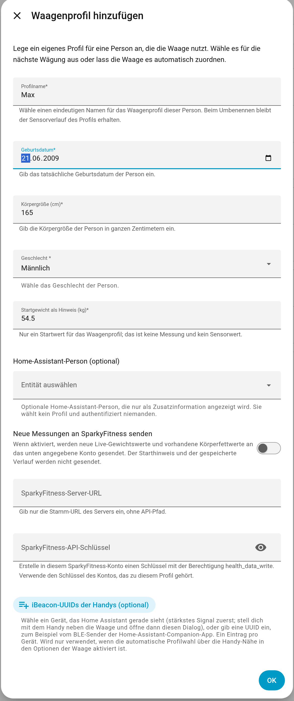

*Die Profilfelder, wie sie unter **Profil hinzufügen** erscheinen. Das erste Einrichtungsformular hat dieselben Felder sowie die MAC-Adresse und die Verbindungsoptionen. Das Geburtsdatum verwendet das Datumsformat deines Browsers.*

Sende das Formular einmal ab. Schließe Huawei Health, stell dich barfuß auf die Waage und bleib still stehen, bis die Wägung abgeschlossen ist. Die Sensoren erhalten erst Werte, wenn Home Assistant eine echte Messung empfängt; das Startgewicht als Hinweis füllt sie nicht.

## Profile hinzufügen und auswählen

Öffne die Seite der Integration Huawei AH100 unter **Einstellungen → Geräte & Dienste** und wähle **Profil hinzufügen**, um ein weiteres Profil anzulegen. Auf derselben Seite kannst du ein Profil bearbeiten oder umbenennen. Profilnamen müssen eindeutig sein. Beim Umbenennen eines Profils bleiben die Identität seiner Sensoren und ihr Verlauf erhalten.

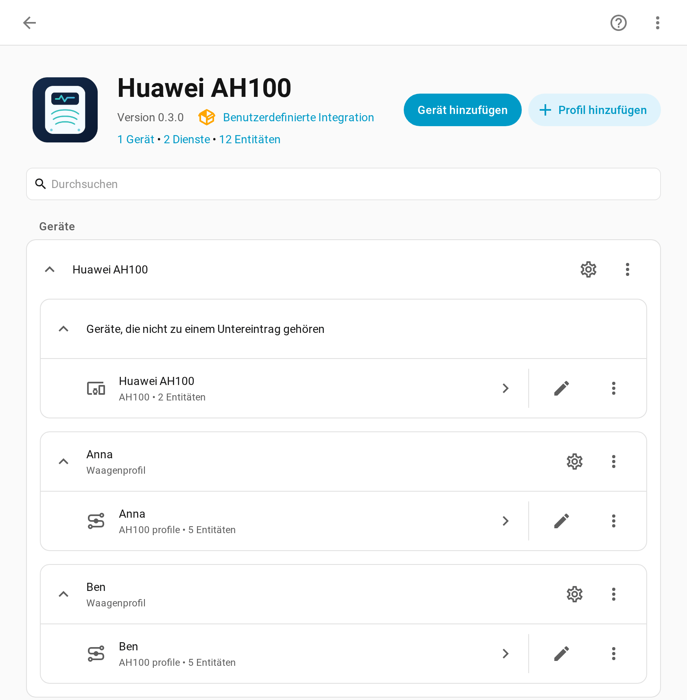

*Die Integrationsseite: ein Waagengerät und ein Gerät pro Profil. **Profil hinzufügen** legt ein weiteres Profil an; das Zahnrad-Symbol eines Profils bearbeitet es.*

Jedes Profil hat getrennte Messungen und ein eigenes Gerät in Home Assistant, das mit der physischen Waage verknüpft ist. Wenn du von der früheren Einrichtung mit nur einem Profil aktualisierst, wird daraus **Profile 1**; dabei bleiben die bisherigen Sensor-IDs, Messwerte und der Verlauf erhalten.

Die Einstellungen **Benutzer-ID der Waage**, **Kopplung bzw. Bindung erlauben** und die optionale Einstellung **Profil bei jeder Wägung bestätigen lassen** gelten für alle Profile gemeinsam und befinden sich in den Verbindungsoptionen der Integration. Die Benutzer-ID ist der Authentifizierungsplatz der Waage, nicht die Profil-ID. Die Auswahl eines Profils ändert diese Einstellung nicht und bindet die Waage nicht neu. Läuft bereits eine Wägesitzung, lässt Home Assistant sie zu Ende laufen und ordnet das Ergebnis dem ursprünglichen Profil zu, bevor die nächste Sitzung das neu gewählte Profil verwendet.

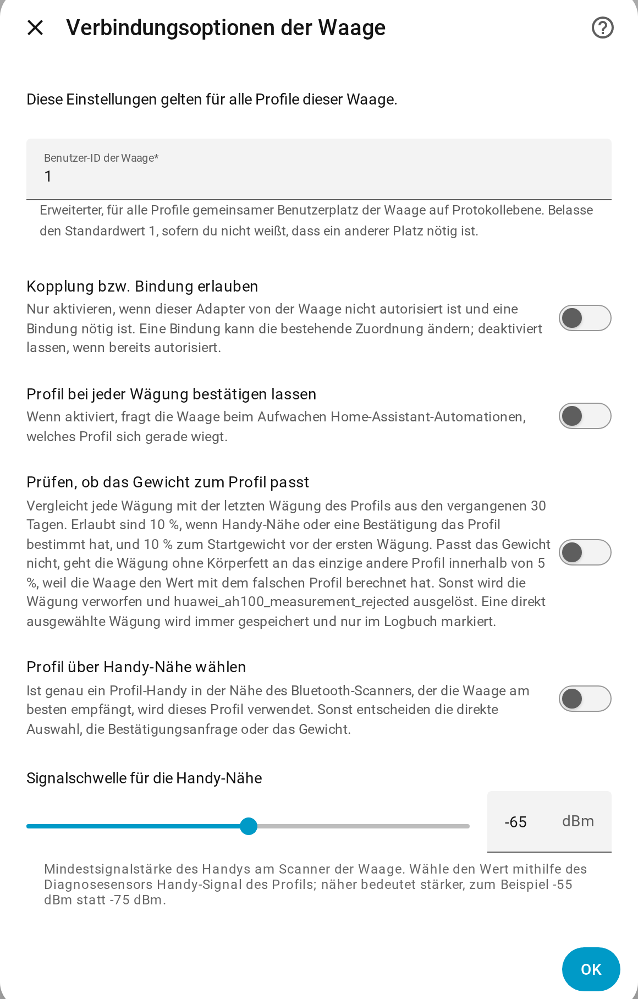

*Die Verbindungsoptionen der Waage, geöffnet über das Zahnrad-Symbol der Waage.*

## Profilzuordnung

Die Integration bestimmt das Profil jeder Wägung in dieser Reihenfolge:

1. **Direkte Auswahl:** Wähle die Person in der Auswahl **Profil für nächste Wägung** der Waage. Die Auswahl gilt nur für die nächste gespeicherte Wägung; danach springt die Auswahl zurück auf **Automatisch**. Eine Auswahl bleibt über einen Neustart hinweg nicht erhalten.
2. **Profilbestätigung**, falls aktiviert (siehe unten).
3. **Handy-Nähe**, falls aktiviert (siehe [Automatische Profilwahl über die Handy-Nähe](#automatische-profilwahl-über-die-handy-nähe)).
4. **Gewicht:** Bei **Automatisch** und ohne Handy in der Nähe geht die Wägung an das einzige Profil, dessen letzte Wägung – oder vor der ersten Wägung dessen Startgewicht als Hinweis – innerhalb von 5 % liegt (10 % beim Hinweis). Passen zwei oder mehr Profile oder gar keines, wird die Wägung verworfen und `huawei_ah100_measurement_rejected` ausgelöst, mit `reason` `ambiguous_weight` oder `no_matching_profile` und den passenden Profilen in `candidates`. Die Waage berechnet das Körperfett mit dem Profil, für das sie eingerichtet war, also dem der zuletzt gewogenen Person; deshalb wird das Körperfett verworfen, wenn die Wägung an jemand anderen geht. Gibt es nur ein Profil, geht jede Wägung an dieses.

Jede Aktivierung und Deaktivierung wird protokolliert. Der Sensor **Zugeordnetes Profil** zeigt das Profil, das für die nächste Wägung aktiv ist, oder **Automatisch**, mit den Attributen `method` (`selection`, `confirmation` oder `proximity`) und `activated_at`; sein Verlauf zeigt, wann welches Profil aktiv war. Zusätzlich enthalten die Events `huawei_ah100_profile_activated` und `huawei_ah100_profile_deactivated` die Felder `entry_id`, `profile_id`, `profile_name`, `method`, optional `person_entity_id` und bei einer Deaktivierung einen `reason`: `weighing_saved`, `replaced`, `deselected`, `out_of_range`, `multiple_phones_nearby` oder den Abbruchgrund einer Bestätigung. Das Logbuch listet diese Events zusammen mit gespeicherten Wägungen, dem Profil, für das sie gespeichert wurden (`profile_name` in `huawei_ah100_measurement_saved`), und der Art ihrer Zuordnung (`assigned_by`) sowie verworfene Wägungen mit ihrem Grund und den betroffenen Profilen.

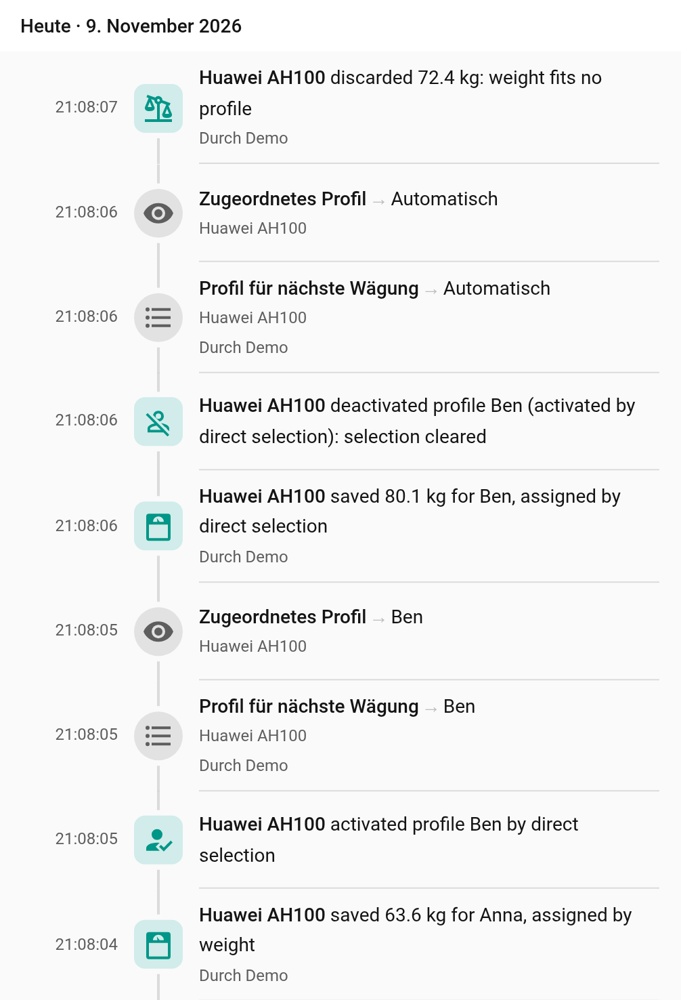

*Logbucheinträge, neueste zuerst: eine Wägung, die zu keinem Profil passte, Ben direkt ausgewählt samt gespeicherter Wägung, und eine Wägung, die nach Gewicht Anna zugeordnet wurde. Die Texte der Einträge gibt die Integration nur auf Englisch aus.*

## Optionale Haushalts-Automationen

Ohne diese Option kommt das Profil aus der Auswahl, von einem Handy in der Nähe oder aus dem Gewicht. Damit Home-Assistant-Automationen das Profil bei jeder Wägung bestätigen, aktiviere **Profil bei jeder Wägung bestätigen lassen** in den Integrationsoptionen der Waage. Die Ersteinrichtung zeigt diese Option nicht an.

Ist sie aktiviert, löst das Aufwachen der Waage `huawei_ah100_weighing_requested` aus, mit der `entry_id` der Waage, einer `request_id`, einer Ablaufzeit in `expires_at` und den eingerichteten Profilen (`profile_id`, `name` und optional `person_entity_id`). Die Integration entscheidet nicht, wer zu Hause ist, und verschickt keine Benachrichtigungen; lege dafür Home-Assistant-Automationen für deinen Haushalt an. Sie können automatisch zuordnen, wenn die Logik deines Haushalts genau eine infrage kommende Person erkennt, oder Benachrichtigungen mit Aktionen senden, wenn sich mehrere Personen wiegen könnten. Übergib bei einer Benachrichtigung mit Aktionen den Wert `trigger.event.context.user_id` des ursprünglichen Events als `claimant_user_id`; verwende diesen Event-Kontext und keinen Identitätswert aus den Aktionsdaten der Benachrichtigung.

Eine Automation bestätigt ein Profil mit `huawei_ah100.claim_weighing` und übergibt dabei `entry_id` und `request_id` aus dem Event sowie die gewählte `profile_id`. Das optionale Feld `claimant_user_id` ist für den authentifizierten Home-Assistant-Benutzer gedacht, der auf eine Benachrichtigung mit Aktionen getippt hat; lass es bei vertrauenswürdiger automatischer Auswahl leer. Die erste gültige Zuordnung gewinnt. Eine Anfrage wird abgelehnt, wenn sie abgelaufen ist oder die Waage einschläft, die Verbindung trennt oder Home Assistant neu lädt. Nach der Zuordnung bleibt das Profil für diese Messung fest, weil die Waage seine demografischen Angaben zur Berechnung der Körperfettwerte nutzt. Ist die Waage bereits wieder eingeschlafen, wecke sie erneut, ordne die neue Anfrage zu und wiege dich dann.

Die Integration löst `huawei_ah100_profile_confirmed` aus, nachdem sie eine Zuordnung angenommen hat, und `huawei_ah100_weighing_cancelled`, wenn eine Anfrage ohne Messung endet; Letzteres enthält einen `reason`. Sobald eine Messung dauerhaft lokal gespeichert ist, wird `huawei_ah100_measurement_saved` mit ihrer `measurement_id` ausgelöst; damit lässt sich sofort eine lokale Rückmeldung auslösen, etwa ein grünes Blinken. `huawei_ah100_measurement_completed` wird für dieselbe dauerhaft gespeicherte Messung ausgelöst, nachdem SparkyFitness erfolgreich war oder wenn die Synchronisierung deaktiviert ist, mit `sync_status` auf `synced` oder `disabled`. Verwende das Completed-Event für eine abschließende Ergebnis-Benachrichtigung an die Person, der die Messung gehört. Event-Felder und den Ablauf einer Anfrage findest du in den [Protokollnotizen](protocol.md).

## Automatische Profilwahl über die Handy-Nähe

Trägt jedes Haushaltsmitglied ein Handy bei sich, das ein iBeacon aussendet, kann die Waage das Profil selbst wählen. Die Home-Assistant-Companion-App für Android kann das mit ihrem Sensor **BLE-Sender**; jede andere iBeacon-Quelle funktioniert ebenso. Die Bluetooth-Adresse des Handys kann sich ändern, deshalb erkennt die Integration Handys nur an ihrer iBeacon-UUID.

1. Schalte auf jedem Handy den iBeacon-Sender ein.
2. Stell dich mit dem Handy neben die Waage, bearbeite das Profil und wähle das Gerät unter **iBeacon-UUIDs der Handys (optional)**. Die Liste zeigt die iBeacons, die Home Assistant gerade sieht, mit dem stärksten Signal zuerst, zusammen mit dem Scanner, der sie empfängt. Sie wird beim Öffnen des Dialogs gefüllt; öffne ihn also erneut, um sie zu aktualisieren. Du kannst auch eine UUID eintippen, ein Eintrag pro Gerät. Ein Profil kann mehrere UUIDs haben, zum Beispiel ein Handy und einen Tag, aber jede UUID kann nur zu einem Profil gehören.
3. Aktiviere den Diagnosesensor **Handy-Signal** des Profils. Er ist standardmäßig deaktiviert. Er zeigt das stärkste Signal der Geräte dieses Profils an dem Bluetooth-Scanner, der die Waage am besten empfängt, zum Beispiel einem ESPHome-Bluetooth-Proxy im Badezimmer. Werte, die älter als 10 Sekunden sind, werden ignoriert.
4. Stell dich mit dem Handy an die Waage, und zwar dort am Körper, wo du es normalerweise trägst, und notiere den Wert. Notiere dann den Wert von dort, wo sich andere Personen üblicherweise aufhalten, zum Beispiel im Nebenzimmer.
5. Aktiviere in den Integrationsoptionen der Waage **Profil über Handy-Nähe wählen** und setze **Signalschwelle für die Handy-Nähe** auf einen Wert zwischen diesen beiden Werten. Der Standard ist -65 dBm.

Solange genau ein Profil-Handy an diesem Scanner auf oder über der Schwelle liegt, ist dieses Profil aktiv, und eine Wägung verwendet es, sofern kein Profil direkt ausgewählt wurde. Die Integration prüft alle 5 Sekunden und protokolliert, wann das Handy kommt und geht. Mit **Profil bei jeder Wägung bestätigen lassen** bestätigt die Integration das Profil selbst: Sie überspringt `huawei_ah100_weighing_requested` und löst `huawei_ah100_profile_confirmed` mit `source: proximity` aus; eine direkte Auswahl wird auf dieselbe Weise mit `source: selection` bestätigt. Mehrere Geräte desselben Profils zählen als eines. Sind Handys von zwei oder mehr Profilen gleichzeitig in der Nähe, entscheidet die Nähe nicht: `huawei_ah100_multiple_phones_nearby` wird mit `profile_ids` und `profile_names` ausgelöst, ein durch Nähe aktiviertes Profil wird mit dem Grund `multiple_phones_nearby` deaktiviert, und die Wägung wird nach Gewicht zugeordnet. Wird diese Wägung dann verworfen, listet `huawei_ah100_measurement_rejected` diese Profile zusätzlich in `nearby_profiles` auf. Ist kein Handy in der Nähe, wird die Wägung ebenfalls nach Gewicht zugeordnet. Handy-UUIDs und Signalwerte bleiben in Home Assistant und werden nie an SparkyFitness gesendet.

## Plausibilitätsprüfung des Gewichts

Aktiviere **Prüfen, ob das Gewicht zum Profil passt** in den Integrationsoptionen der Waage, um Wägungen abzufangen, die für die falsche Person gespeichert würden. Das gilt für Wägungen, deren Profil bestätigt oder über die Handy-Nähe gefunden wurde; Wägungen, die nach Gewicht zugeordnet werden, werden immer wie unter [Profilzuordnung](#profilzuordnung) beschrieben geprüft. Jede Wägung wird mit der letzten Wägung des Profils aus den vergangenen 30 Tagen verglichen:

- bis zu 10 % Abweichung werden akzeptiert;
- vor der ersten Wägung eines Profils wird sein Startgewicht als Hinweis mit 10 % verwendet;
- ist die letzte Wägung älter als 30 Tage, wird die Wägung ohne Prüfung akzeptiert, damit nach einer langen Pause oder einer Diät keine Daten verloren gehen.

Passt eine Wägung nicht, geht sie an das einzige andere Profil innerhalb von 5 %. Die Waage hat das Körperfett mit Körpergröße, Alter und Geschlecht des falschen Profils berechnet; deshalb behält eine verschobene Wägung Gewicht und Impedanz, aber kein Körperfett, und `huawei_ah100_measurement_saved` enthält dann `redirected_from`. Passt kein anderes Profil oder mehr als eines, wird die Wägung verworfen und `huawei_ah100_measurement_rejected` mit `entry_id`, `profile_id`, `reason` `weight_mismatch`, `weight_kg`, `reference_weight_kg` und `impedance_ohm` ausgelöst. Die Prüfung kann Personen nicht unterscheiden, deren Gewichte weniger als 5 % auseinanderliegen.

Eine direkt ausgewählte Wägung wird nie verschoben oder verworfen, damit eine echte Gewichtsänderung oder eine falsche frühere Wägung ein Profil nicht blockieren kann. Besteht sie die Prüfung nicht, wird sie trotzdem gespeichert, und `huawei_ah100_measurement_saved` enthält `weight_check_overridden: true`, was das Logbuch anzeigt.

## SparkyFitness-Synchronisierung

Die SparkyFitness-Synchronisierung ist optional und wird in jedem Profil separat eingerichtet. So aktivierst du sie:

1. Aktiviere **Neue Messungen an SparkyFitness senden** im Profilformular.
2. Gib die Stamm-URL des Servers ein, etwa `https://fitness.example.com`; hänge keinen API-Pfad an.
3. Erstelle im zugehörigen SparkyFitness-Konto einen API-Schlüssel mit der Berechtigung `health_data_write` und gib den Schlüssel dieses Kontos ein. Gib dem Profil jeder Person den Schlüssel ihres eigenen Kontos; verwende nicht denselben Schlüssel eines gemeinsamen Kontos für mehrere Profile.

Wenn du ein Profil später bearbeitest, lass das Feld für den API-Schlüssel leer, um den gespeicherten Schlüssel zu behalten; Home Assistant füllt es nicht vor.

Diese Integration sendet nur neue Live-Wägungen: das Gewicht in Kilogramm und, sofern vorhanden, den Körperfettanteil in Prozent. Sie sendet weder das Startgewicht als Hinweis noch den gespeicherten Verlauf, Profilfelder oder die Impedanz. Sie schickt einen `POST` an `/api/measurements/health-data`, einen Endpunkt, den es in [SparkyFitness v0.17.3](https://github.com/CodeWithCJ/SparkyFitness/blob/2a7e0d8f317fff14fc6596d573df0c2ae6ba6f9d/SparkyFitnessServer/routes/measurementRoutes.ts) gibt. SparkyFitness speichert pro Konto einen täglichen Check-in; eine weitere Wägung am selben Tag aktualisiert die Werte dieses Tages. Die Anfrage enthält ein Datum ohne Uhrzeit, gemäß dem lokalen Kalendertag in Home Assistant; die Zeitzone des SparkyFitness-Kontos sollte daher mit der von Home Assistant übereinstimmen. Der genaue Zeitpunkt der Wägung und die Impedanz bleiben in Home Assistant verfügbar.

Der Sensor **SparkyFitness-Synchronisierung** meldet `disabled`, `pending`, `synced` oder `error`. Ein eingerichtetes Profil kann vor seiner ersten bestätigten Synchronisierung `pending` anzeigen. Ist der Server nicht erreichbar, bleibt eine Messung in der Warteschlange, und die Synchronisierung wird später erneut versucht. Eine Änderung der URL oder des API-Schlüssels ordnet eine wartende Messung keinem anderen Konto zu. Die Einrichtung der Integration erzeugt keine Testmessung und überträgt keine alten Messwerte nachträglich.

## Dashboard-Karten

Die Integration bringt zwei Dashboard-Karten mit. Sie werden automatisch geladen; ein Ressourceneintrag oder ein separater Download ist nicht nötig. Bearbeite ein Dashboard, wähle **Karte hinzufügen** und suche nach **Huawei AH100**. Lade nach einem Update die Browserseite einmal neu.

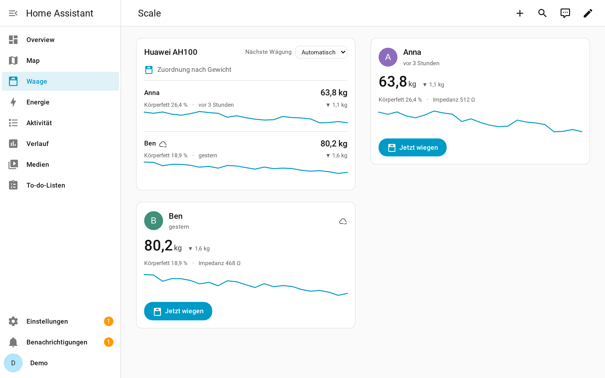

*Beispiel-Dashboard mit Demodaten: die Waagenkarte und eine Profilkarte pro Person.*

- **Huawei-AH100-Waage** (`custom:huawei-ah100-card`): alle Profile einer Waage mit ihrem letzten Gewicht, Körperfett, dem Zeitpunkt der letzten Wägung, dem SparkyFitness-Status und einem 30-Tage-Verlauf aus den Tagesmittelwerten. Ein Auswahlmenü legt das Profil für die nächste Wägung fest, eine Zeile zeigt, welches Profil aktiv ist und wodurch, und eine in den letzten 24 Stunden verworfene Wägung wird mit ihrem Grund angezeigt. Wähle ein Profil, um seinen Gewichtsverlauf zu öffnen.
- **Huawei-AH100-Profil** (`custom:huawei-ah100-profile-card`): ein Profil mit dem Bild der Person, Gewicht, Verlauf, Körperfett und Impedanz sowie einer Schaltfläche **Jetzt wiegen**. Die Schaltfläche wählt dieses Profil für die nächste Wägung; die Karte fordert dich dann auf, auf die Waage zu steigen, und bietet **Abbrechen** an. Hat die Handy-Nähe oder eine Bestätigung das Profil aktiviert, zeigt die Karte das an.

| Waagenkarte | Profil ausgewählt | Wägung verworfen |
| --- | --- | --- |
| 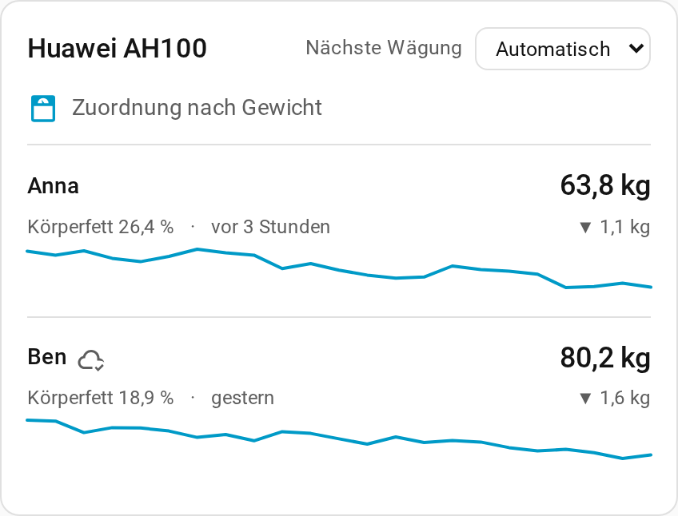 | 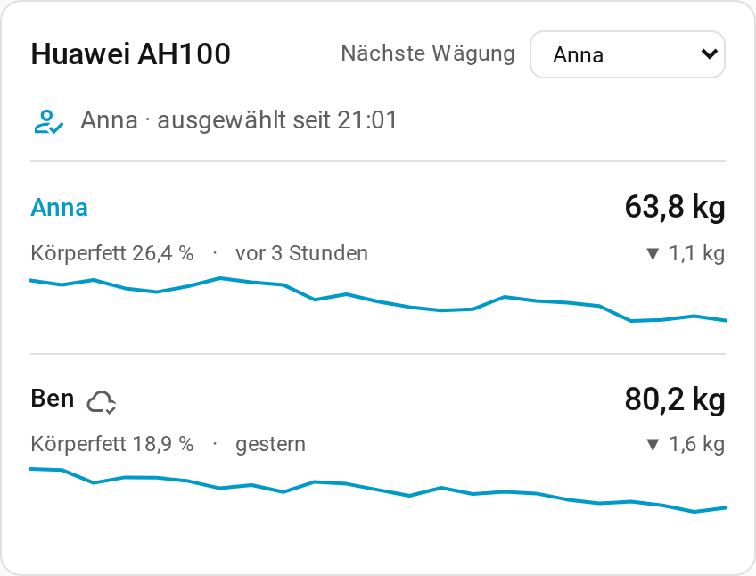 | 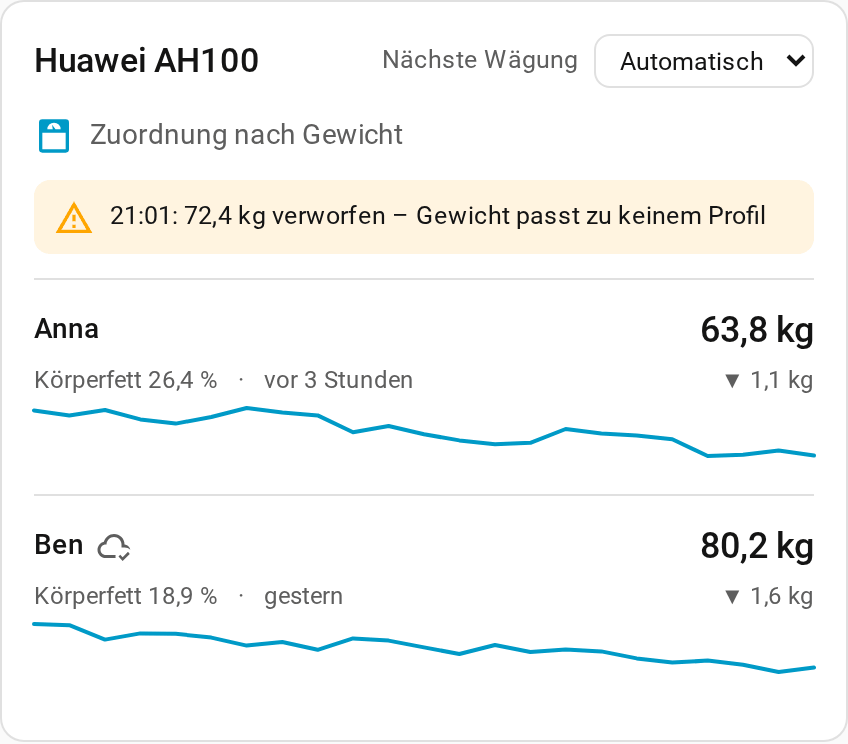 |

| Profilkarte | Nach **Jetzt wiegen** |
| --- | --- |
| 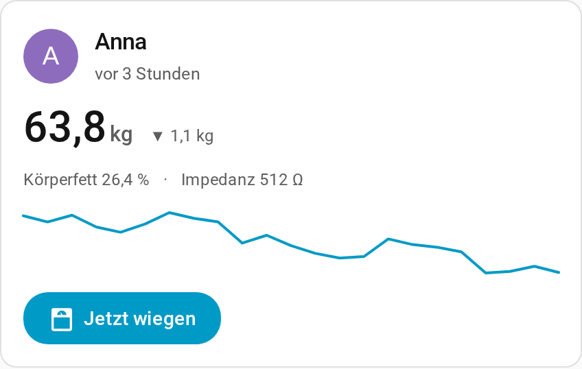 | 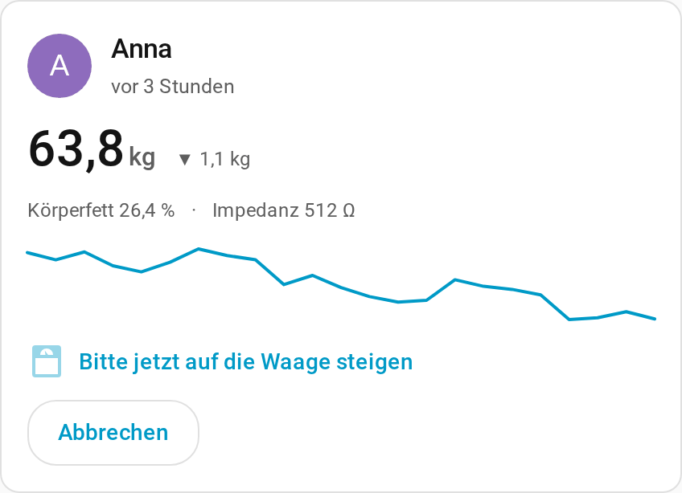 |

```yaml
type: custom:huawei-ah100-card
device_id: <Waagengerät>
---
type: custom:huawei-ah100-profile-card
device_id: <Profilgerät>
```

Beide Karten akzeptieren optional einen `title`. Sie folgen dem Dashboard-Design und verwenden je nach Sprache von Home Assistant Englisch, Deutsch oder Französisch. Der Verlauf benötigt Langzeitstatistiken und erscheint daher nach dem ersten Tag mit Wägungen.

## Fehlerbehebung

- **Die Geräteauswahl ist leer oder zeigt keinen Waagennamen:** Schließe Huawei Health, wecke die Waage und versuche es in Bluetooth-Reichweite erneut. Prüfe, ob der Bluetooth-Adapter von Home Assistant im Modus **Automatisch** oder **Aktiv** ist, damit die erste Suche den angekündigten Namen abrufen kann. Scannt er nur passiv, verwende **Manuelle Einrichtung** und gib die MAC-Adresse ein.
- **Sensoren sind nicht verfügbar:** Wähle die Person unter **Profil für nächste Wägung**, wiege dich dann barfuß und bleib still stehen, bis die Waage fertig ist. Die Sensoren brauchen eine echte Messung, bevor sie Werte haben.
- **Die Authentifizierung wird abgelehnt:** Wenn dieser Adapter von der Waage nicht autorisiert ist, aktiviere **Kopplung bzw. Bindung erlauben** in den Verbindungsoptionen der Integration und wecke die Waage dann erneut. Eine Bindung kann die bestehende Zuordnung ändern; aktiviere sie nur bei Bedarf.
- **Ein Handy ist verbunden oder Home Assistant kann keine Verbindung herstellen:** Schließe Huawei Health, trenne andere Handys oder Clients von der Waage und prüfe dann die ausgewählte oder eingegebene MAC-Adresse.
- **Die SparkyFitness-Synchronisierung bleibt ausstehend oder meldet einen Fehler:** Prüfe die Erreichbarkeit des Servers, die URL des Profils und ob sein API-Schlüssel zum richtigen Konto gehört und die Berechtigung `health_data_write` hat. Stelle sicher, dass dieses Konto und Home Assistant dieselbe Zeitzone verwenden.

## Datenschutz und Datenverarbeitung

Die Bluetooth-Kommunikation mit der Waage erfolgt lokal. Es gehen keine Messungen oder Profilwerte an einen Cloud-Dienst, sofern du nicht die SparkyFitness-Synchronisierung für ein Profil aktivierst. Ist sie aktiviert, werden nur neue Live-Gewichtswerte, vorhandene Körperfettanteile und das lokale Datum von Home Assistant an den für dieses Profil eingerichteten SparkyFitness-Server gesendet. Geburtsdatum, Körpergröße, Geschlecht, Personen-Entität, der genaue Zeitpunkt der Wägung und die Impedanz werden nicht an SparkyFitness gesendet.

Die zuletzt akzeptierte Live-Messung wird im privaten Integrationsspeicher von Home Assistant abgelegt, damit Entitäten wiederhergestellt werden können und das tatsächliche Gewicht als nächster Profilhinweis wiederverwendet werden kann. Der vollständige dekodierte Datensatz wird nicht in Sensorzuständen oder -attributen veröffentlicht; die Sensorattribute enthalten nur die dokumentierten Metadaten der Messung.

Gib deine Waagen-MAC-Adresse, dein Geburtsdatum, Profilwerte, API-Schlüssel oder ungeschwärzte Bluetooth-Mitschnitte nicht in öffentlichen Issues an. Wenn du ein Problem meldest, nenne das Waagenmodell, die Firmware und die Home-Assistant-Version, ohne persönliche Kennungen.

## Mitwirken

Siehe [CONTRIBUTING.md](../CONTRIBUTING.md) für die Entwicklungsumgebung, Tests und Stilprüfungen. Die Protokollnotizen und die Grenzen der Validierung stehen in [docs/protocol.md](protocol.md).

## Lizenz und Namensnennung

Dieses Projekt steht unter der Lizenz **GPL-3.0-or-later**. Die Protokollimplementierung ist eine Portierung von Kotlin nach Python auf Basis von openScales [`HuaweiAhCh100Handler.kt`](https://github.com/oliexdev/openScale/blob/39a0c5c25a0abc26b8e24c90f36b5a2c6ff07a4a/android_app/app/src/main/java/com/health/openscale/core/bluetooth/scales/HuaweiAhCh100Handler.kt) im Commit [`39a0c5c25a0abc26b8e24c90f36b5a2c6ff07a4a`](https://github.com/oliexdev/openScale/commit/39a0c5c25a0abc26b8e24c90f36b5a2c6ff07a4a). Umfang des Protokolls und Details zur Namensnennung findest du in [docs/protocol.md](protocol.md).
