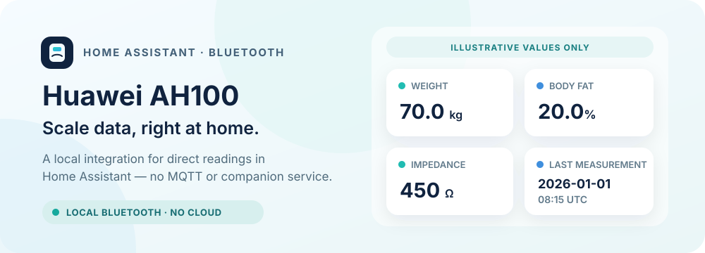

# Huawei AH100 pour Home Assistant

[English](../README.md) | [Français](README.fr.md)

Une intégration Bluetooth locale et non officielle pour lire dans Home Assistant les mesures de composition corporelle d’une balance Huawei AH100.

> **État de validation :** le protocole BLE a été validé avec une balance Huawei AH100/CH100 équipée d’un contrôleur Chipsea CST34M97 et du firmware 1050, à l’aide d’un Raspberry Pi. La pesée via l’intégration native Home Assistant et la synchronisation SparkyFitness authentifiée n’ont pas encore été validées de bout en bout.

## Fonctionnalités

Chaque balance configurée correspond à un appareil physique dans Home Assistant. Vous pouvez créer un profil nommé pour chaque personne qui l’utilise et choisir explicitement le profil actif avant la pesée. L’intégration ne déduit pas l’identité de la personne à partir de son poids. Si une pesée est déjà en cours, laissez-la se terminer avant de changer de profil ; Home Assistant associe le résultat au profil actif au début de la session.

Chaque profil possède son propre appareil logique lié à la balance physique et quatre capteurs de mesure :

| Entité | Unité | Signification |
| --- | --- | --- |
| Poids | kg | Poids mesuré en direct |
| Masse grasse | % | Valeur rapportée par la balance |
| Impédance | Ω | Impédance électrique rapportée par la balance |
| Dernière mesure | UTC | Heure de réception de la dernière mesure valide par Home Assistant |

L’appareil physique de la balance possède aussi un sélecteur **Profil actif**. Chaque appareil de profil inclut un capteur de diagnostic **Synchronisation SparkyFitness** : il indique « désactivée » si la synchronisation est désactivée, « en attente » avant une première synchronisation confirmée ou tant que des données attendent, « synchronisée » après succès et « erreur » après un échec.

Les attributs de mesure comprennent `user_id`, l’horodatage local de la balance (`device_measured_at`), son champ de jour de la semaine (`weekday`) et les octets de fin non interprétés (`unknown_tail_hex`). Ces octets restent explicitement inconnus : ils ne sont pas présentés comme de la graisse viscérale ou une autre mesure corporelle. L’intégration ne calcule pas l’eau, les muscles, les os, l’IMC, le métabolisme de base ni d’autres valeurs dérivées.

Le poids initial sert uniquement d’indication lors de la synchronisation d’un profil avec la balance. Ce n’est pas une mesure et il n’est jamais publié comme valeur d’un capteur. Après une mesure réelle, ce poids mesuré peut servir de prochaine indication de profil.

## Prérequis et état du projet

- Home Assistant **2026.10.0 ou plus récent**.
- Une balance Huawei AH100/CH100 prise en charge et un adaptateur Bluetooth accessible par Home Assistant.
- Huawei Health doit être déconnecté de la balance pendant la configuration et les pesées. La balance n’accepte qu’une connexion Bluetooth centrale active à la fois.

La configuration initiale demande au Bluetooth de Home Assistant de rechercher activement les balances CH100 connectables à proximité et affiche un choix lorsqu’il en trouve une. Après configuration, la détection Bluetooth de Home Assistant repère le réveil de la balance. Les proxies Bluetooth n’ont pas été vérifiés. L’intégration n’a besoin ni de MQTT, ni de Docker, ni d’un service compagnon, ni d’un compte cloud.

Ce projet communautaire indépendant n’est pas affilié à Huawei. La version de l’intégration est **0.2.0**. La demande d’ajout au catalogue HACS par défaut est [ouverte et en attente de l’examen des mainteneurs](https://github.com/hacs/default/pull/12666) ; en attendant son acceptation, ajoutez le dépôt comme dépôt personnalisé avec le bouton ci-dessus.

## Installation

### HACS

1. Installez [HACS](https://hacs.xyz/docs/use/) si ce n’est pas déjà fait dans Home Assistant.
2. Sélectionnez le bouton HACS ci-dessus. Si demandé, ajoutez `frankbrg/huawei-ah100` comme dépôt personnalisé de catégorie **Integration**.
3. Téléchargez l’intégration puis redémarrez Home Assistant.
4. Sélectionnez le bouton **Ajouter l’intégration** ci-dessus, ou ouvrez **Paramètres → Appareils et services → Ajouter une intégration** et recherchez **Huawei AH100**. Home Assistant lance alors une recherche à proximité.

### Installation manuelle

1. Copiez `custom_components/huawei_ah100` de ce dépôt dans `<config>/custom_components/huawei_ah100` de votre répertoire de configuration Home Assistant.
2. Redémarrez Home Assistant.
3. Ajoutez **Huawei AH100** depuis **Paramètres → Appareils et services**.

## Configurer la balance et le premier profil

Fermez Huawei Health sur les téléphones proches, placez Home Assistant à portée Bluetooth et montez brièvement sur la balance pour la réveiller. Dans la liste des appareils proches, sélectionnez la balance CH100 connectable. Si Home Assistant a déjà détecté la balance et affiche une carte d’intégration, sélectionnez **Configurer** ; ce parcours ne demande pas d’adresse MAC.

Si la recherche ne trouve aucune balance, réveillez-la à nouveau puis sélectionnez **Relancer la recherche**, ou choisissez **Configuration manuelle** et saisissez son adresse MAC Bluetooth. Certains adaptateurs passifs reçoivent les annonces Bluetooth sans pouvoir récupérer le nom annoncé nécessaire au premier choix ; utilisez alors la configuration manuelle. Une fois la balance configurée, la détection passive suffit pour repérer son réveil.

Le formulaire initial crée le premier profil nommé et configure la connexion partagée. Renseignez :

- **Nom du profil :** un nom qui indique à qui appartiennent les mesures.
- **Date de naissance :** la date réelle de la personne du profil, au format `JJ/MM/AAAA` (exemple fictif : `31/01/2000`).
- **Taille :** la taille de la personne en centimètres entiers.
- **Sexe :** la valeur du profil de la personne qui utilisera la balance.
- **Poids initial indicatif :** une valeur de départ pour le profil de la balance. Ce n’est pas une mesure ni une valeur de capteur.
- **Personne Home Assistant (facultatif) :** une entité Personne liée comme métadonnée en lecture seule. Elle ne sélectionne pas le profil actif et n’authentifie pas la personne.
- **Synchronisation SparkyFitness (facultative) :** laissez-la désactivée sauf si vous souhaitez envoyer les nouvelles mesures de ce profil à SparkyFitness ; voir [Synchronisation SparkyFitness](#synchronisation-sparkyfitness).
- **Identifiant utilisateur de la balance :** emplacement utilisé pour l’authentification Bluetooth, `1` par défaut. Ce réglage est partagé par tous les profils ; gardez `1` sauf si vous savez qu’un autre emplacement est nécessaire.
- **Autoriser l’association :** réglage de connexion partagé. Activez-le si cet adaptateur n’a pas été autorisé par la balance et qu’une association est nécessaire. Cela peut modifier l’association existante ; laissez-le désactivé si l’adaptateur est déjà autorisé.

Validez le formulaire une seule fois. Fermez Huawei Health, montez pieds nus sur la balance et restez immobile jusqu’à la fin de la pesée. Les capteurs ne reçoivent des valeurs qu’après la réception d’une mesure réelle par Home Assistant ; le poids initial indicatif ne les alimente pas.

## Ajouter et choisir des profils

Ouvrez la page de l’intégration Huawei AH100 dans **Paramètres → Appareils et services**, puis sélectionnez **Ajouter un profil** pour créer un autre profil. Vous pouvez modifier ou renommer un profil depuis la même page. Chaque nom doit être unique. Renommer un profil conserve l’identité de ses capteurs et leur historique.

Avant de monter sur la balance, choisissez la personne dans le sélecteur **Profil actif** de l’appareil physique. Chaque profil possède ses propres mesures et son propre appareil Home Assistant, lié à la balance physique. Après la mise à jour depuis l’ancienne configuration à profil unique, elle devient **Profile 1** et conserve ses identifiants de capteurs, ses mesures et leur historique.

L’**Identifiant utilisateur de la balance** et l’option **Autoriser l’association** sont des réglages de connexion partagés par tous les profils et se trouvent dans les options de l’intégration. Cet identifiant est l’emplacement de la balance utilisé pour l’authentification Bluetooth, pas l’identifiant du profil. Changer de profil actif ne modifie pas ce réglage et ne réassocie pas la balance. Si une session est en cours, Home Assistant la laisse se terminer et associe son résultat au profil d’origine avant d’utiliser le nouveau profil pour la prochaine session.

## Synchronisation SparkyFitness

La synchronisation SparkyFitness est facultative et se configure séparément dans chaque profil :

1. Activez **Synchronisation SparkyFitness** dans le profil.
2. Saisissez l’URL racine du serveur, par exemple `https://fitness.example.com` ; n’ajoutez pas de chemin d’API.
3. Dans le compte SparkyFitness correspondant, créez une clé API avec la permission `health_data_write`, puis saisissez-la. Chaque profil doit utiliser la clé de son propre compte ; ne réutilisez pas une clé globale partagée entre profils.

Lors d’une modification ultérieure du profil, laissez le champ de clé API vide pour conserver la clé enregistrée ; Home Assistant ne la préremplit pas.

L’intégration envoie uniquement les nouvelles pesées réelles : le poids en kilogrammes et le pourcentage de masse grasse lorsqu’il est disponible. Elle n’envoie ni le poids initial indicatif, ni l’historique, ni les champs du profil, ni l’impédance. Elle effectue une requête `POST` vers `/api/measurements/health-data`, une route présente dans [SparkyFitness v0.17.3](https://github.com/CodeWithCJ/SparkyFitness/blob/2a7e0d8f317fff14fc6596d573df0c2ae6ba6f9d/SparkyFitnessServer/routes/measurementRoutes.ts). SparkyFitness stocke une entrée de mesure quotidienne par compte ; une nouvelle pesée le même jour met à jour les valeurs de cette journée. La requête contient une date sans heure, correspondant au jour local de Home Assistant : le fuseau horaire du compte SparkyFitness doit donc correspondre à celui de Home Assistant. L’heure exacte et l’impédance restent disponibles dans Home Assistant.

Le capteur **Synchronisation SparkyFitness** indique « désactivée », « en attente », « synchronisée » ou « erreur ». Un profil configuré peut afficher « en attente » avant sa première synchronisation confirmée. Si le serveur est inaccessible, la mesure reste en file d’attente et l’envoi sera réessayé. Un changement d’URL ou de clé ne redirige pas une mesure en attente vers un autre compte. La configuration ne crée pas de fausse mesure de test et n’envoie pas l’historique.

## Dépannage

- **La liste des appareils proches est vide ou sans nom :** fermez Huawei Health, réveillez la balance et relancez la recherche à portée Bluetooth. Vérifiez que l’adaptateur Bluetooth de Home Assistant est en mode **Automatique** ou **Actif** pour récupérer le nom annoncé. Avec un adaptateur uniquement passif, utilisez **Configuration manuelle** et saisissez l’adresse MAC.
- **Les capteurs sont indisponibles :** choisissez le bon **Profil actif**, puis effectuez une pesée pieds nus et restez immobile jusqu’à la fin. Les capteurs ont besoin d’une mesure réelle pour recevoir leurs valeurs.
- **L’authentification est refusée :** si cet adaptateur n’a pas été autorisé par la balance, activez **Autoriser l’association** dans les options de connexion de l’intégration, puis réveillez à nouveau la balance. L’association peut modifier celle déjà enregistrée ; n’activez cette option qu’en cas de besoin.
- **Un téléphone est connecté ou Home Assistant ne parvient pas à se connecter :** fermez Huawei Health, déconnectez les autres téléphones ou clients de la balance, puis vérifiez l’adresse MAC sélectionnée ou saisie.
- **La synchronisation SparkyFitness reste en attente ou affiche une erreur :** vérifiez l’accès au serveur, l’URL du profil et que sa clé API appartient au bon compte et possède la permission `health_data_write`. Vérifiez aussi que le compte et Home Assistant utilisent le même fuseau horaire.

## Confidentialité et traitement des données

La communication Bluetooth avec la balance est locale. Aucune mesure ni valeur de profil n’est envoyée vers un service cloud tant que la synchronisation SparkyFitness n’est pas activée pour un profil. Si elle est activée, seules les nouvelles valeurs de poids, la masse grasse disponible et la date locale Home Assistant sont envoyées au serveur SparkyFitness configuré pour ce profil. La date de naissance, la taille, le sexe, l’entité Personne, l’heure exacte de pesée et l’impédance ne sont pas envoyés à SparkyFitness.

La dernière mesure réelle acceptée est enregistrée dans le stockage privé de l’intégration Home Assistant afin de restaurer les entités et de réutiliser le poids mesuré comme prochaine indication de profil. L’enregistrement décodé complet n’est pas publié dans les états ou attributs des capteurs ; leurs attributs exposent uniquement les métadonnées de mesure documentées.

Ne publiez pas l’adresse MAC de votre balance, vos dates de naissance, valeurs de profil, clés API ni des captures Bluetooth non expurgées. Pour signaler un problème, indiquez le modèle et le firmware de la balance ainsi que la version de Home Assistant, sans identifiant personnel.

## Contribution

Consultez [CONTRIBUTING.md](../CONTRIBUTING.md) pour l’environnement de développement, les tests et les contrôles de style. Les notes de protocole et les limites de validation sont dans [protocol.md](protocol.md).

## Licence et attribution

Ce projet est distribué sous licence **GPL-3.0-or-later**. L’implémentation du protocole est un portage Kotlin vers Python basé sur [`HuaweiAhCh100Handler.kt`](https://github.com/oliexdev/openScale/blob/39a0c5c25a0abc26b8e24c90f36b5a2c6ff07a4a/android_app/app/src/main/java/com/health/openscale/core/bluetooth/scales/HuaweiAhCh100Handler.kt) du projet openScale, au commit [`39a0c5c25a0abc26b8e24c90f36b5a2c6ff07a4a`](https://github.com/oliexdev/openScale/commit/39a0c5c25a0abc26b8e24c90f36b5a2c6ff07a4a). Consultez [protocol.md](protocol.md) pour le périmètre du protocole et les détails d’attribution.
