# Huawei AH100 pour Home Assistant

[English](../README.md) | [Français](README.fr.md) | [Deutsch](README.de.md)

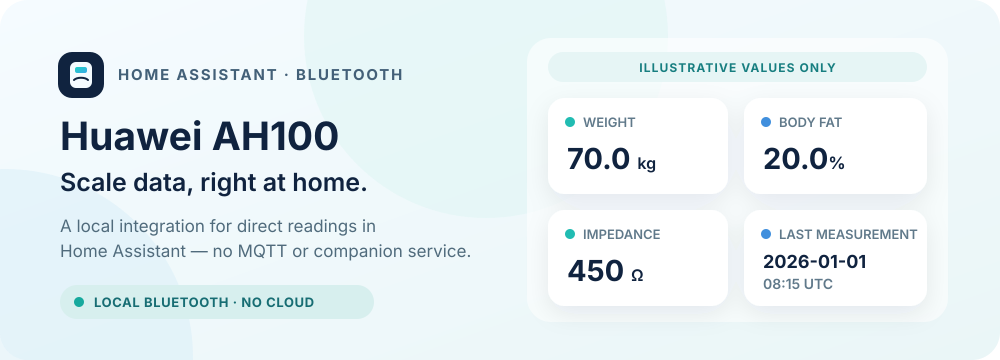

Une intégration Bluetooth locale et non officielle pour lire dans Home Assistant les mesures de composition corporelle d’une balance Huawei AH100.

[](https://github.com/frankbrg/huawei-ah100/actions/workflows/validate.yaml)
[](https://github.com/frankbrg/huawei-ah100/releases)
[](../LICENSE)

[](https://my.home-assistant.io/redirect/hacs_repository/?owner=frankbrg&repository=huawei-ah100&category=integration)
[](https://my.home-assistant.io/redirect/config_flow_start/?domain=huawei_ah100)

> **État de validation :** l’ancien parcours manuel de profil Home Assistant a reçu une vraie mesure de la balance. Le nouveau flux de confirmation du profil et d’automatisation du foyer, ainsi que l’export vers SparkyFitness, n’ont pas encore été validés de bout en bout sur le matériel.

## Fonctionnalités

Chaque balance configurée correspond à un appareil physique dans Home Assistant. Vous pouvez créer un profil nommé pour chaque personne qui l’utilise. Le profil d’une pesée provient d’une sélection directe, d’une confirmation, d’un téléphone proche ou, à défaut, du poids lui-même ; voir [Attribution du profil](#attribution-du-profil). Si une pesée est déjà en cours, laissez-la se terminer avant de changer de profil ; Home Assistant associe le résultat au profil choisi au début de la session.

Chaque profil possède son propre appareil logique lié à la balance physique et quatre capteurs de mesure :

| Entité | Unité | Signification |
| --- | --- | --- |
| Poids | kg | Poids mesuré en direct |
| Masse grasse | % | Valeur rapportée par la balance |
| Impédance | Ω | Impédance électrique rapportée par la balance |
| Dernière mesure | UTC | Heure de réception de la dernière mesure valide par Home Assistant |

L’appareil physique de la balance possède aussi un sélecteur **Profil pour la prochaine pesée** et un capteur **Profil attribué**. Chaque appareil de profil inclut un capteur de diagnostic **Synchronisation SparkyFitness** : il indique « désactivée » si la synchronisation est désactivée, « en attente » avant une première synchronisation confirmée ou tant que des données attendent, « synchronisée » après succès et « erreur » après un échec.

Les attributs de mesure comprennent `user_id`, l’horodatage local de la balance (`device_measured_at`), son champ de jour de la semaine (`weekday`) et les octets de fin non interprétés (`unknown_tail_hex`). Ces octets restent explicitement inconnus : ils ne sont pas présentés comme de la graisse viscérale ou une autre mesure corporelle. L’intégration ne calcule pas l’eau, les muscles, les os, l’IMC, le métabolisme de base ni d’autres valeurs dérivées.

Le poids initial sert uniquement d’indication lors de la synchronisation d’un profil avec la balance. Ce n’est pas une mesure et il n’est jamais publié comme valeur d’un capteur. Après une mesure réelle, ce poids mesuré peut servir de prochaine indication de profil.

## Prérequis et état du projet

- Home Assistant **2026.10.0 ou plus récent**.
- Une balance Huawei AH100/CH100 prise en charge et un adaptateur Bluetooth accessible par Home Assistant.
- Huawei Health doit être déconnecté de la balance pendant la configuration et les pesées. La balance n’accepte qu’une connexion Bluetooth centrale active à la fois.

La configuration initiale demande au Bluetooth de Home Assistant de rechercher activement les balances CH100 connectables à proximité et affiche un choix lorsqu’il en trouve une. Après configuration, la détection Bluetooth de Home Assistant repère le réveil de la balance. Les proxies Bluetooth n’ont pas été vérifiés. L’intégration n’a besoin ni de MQTT, ni de Docker, ni d’un service compagnon, ni d’un compte cloud.

Ce projet communautaire indépendant n’est pas affilié à Huawei. La version de l’intégration est **0.3.0**. La demande d’ajout au catalogue HACS par défaut est [ouverte et en attente de l’examen des mainteneurs](https://github.com/hacs/default/pull/12666) ; en attendant son acceptation, ajoutez le dépôt comme dépôt personnalisé avec le bouton ci-dessus.

## Installation

### HACS

1. Installez [HACS](https://hacs.xyz/docs/use/) si ce n’est pas déjà fait dans Home Assistant.
2. Sélectionnez le bouton HACS ci-dessus. Si demandé, ajoutez `frankbrg/huawei-ah100` comme dépôt personnalisé de catégorie **Integration**.
3. Téléchargez l’intégration puis redémarrez Home Assistant.
4. Sélectionnez le bouton **Ajouter l’intégration** ci-dessus, ou ouvrez **Paramètres → Appareils et services → Ajouter une intégration** et recherchez **Huawei AH100**. Home Assistant lance alors une recherche à proximité.

### Installation manuelle

1. Copiez `custom_components/huawei_ah100` de ce dépôt dans `<config>/custom_components/huawei_ah100` de votre répertoire de configuration Home Assistant.
2. Redémarrez Home Assistant.
3. Ajoutez **Huawei AH100** depuis **Paramètres → Appareils et services**.

## Configurer la balance et le premier profil

Fermez Huawei Health sur les téléphones proches, placez Home Assistant à portée Bluetooth et montez brièvement sur la balance pour la réveiller. Dans la liste des appareils proches, sélectionnez la balance CH100 connectable. Si Home Assistant a déjà détecté la balance et affiche une carte d’intégration, sélectionnez **Configurer** ; ce parcours ne demande pas d’adresse MAC.

Si la recherche ne trouve aucune balance, réveillez-la à nouveau puis sélectionnez **Relancer la recherche**, ou choisissez **Configuration manuelle** et saisissez son adresse MAC Bluetooth. Certains adaptateurs passifs reçoivent les annonces Bluetooth sans pouvoir récupérer le nom annoncé nécessaire au premier choix ; utilisez alors la configuration manuelle. Une fois la balance configurée, la détection passive suffit pour repérer son réveil.

Le formulaire initial crée le premier profil nommé et configure la connexion partagée. Renseignez :

- **Nom du profil :** un nom qui indique à qui appartiennent les mesures.
- **Date de naissance :** la date réelle de la personne du profil, saisie dans le champ de date du navigateur. Vous pouvez taper le jour, le mois et l'année au format de date de votre navigateur, ou ouvrir le sélecteur pour choisir le mois et l'année.
- **Taille :** la taille de la personne en centimètres entiers.
- **Sexe :** la valeur du profil de la personne qui utilisera la balance.
- **Poids initial indicatif :** une valeur de départ pour le profil de la balance. Ce n’est pas une mesure ni une valeur de capteur.
- **Personne Home Assistant (facultatif) :** une entité Personne liée comme métadonnée en lecture seule. Elle ne sélectionne pas le profil actif et n’authentifie pas la personne.
- **Synchronisation SparkyFitness (facultative) :** laissez-la désactivée sauf si vous souhaitez envoyer les nouvelles mesures de ce profil à SparkyFitness ; voir [Synchronisation SparkyFitness](#synchronisation-sparkyfitness).
- **Identifiant utilisateur de la balance :** emplacement utilisé pour l’authentification Bluetooth, `1` par défaut. Ce réglage est partagé par tous les profils ; gardez `1` sauf si vous savez qu’un autre emplacement est nécessaire.
- **Autoriser l’association :** réglage de connexion partagé. Activez-le si cet adaptateur n’a pas été autorisé par la balance et qu’une association est nécessaire. Cela peut modifier l’association existante ; laissez-le désactivé si l’adaptateur est déjà autorisé.

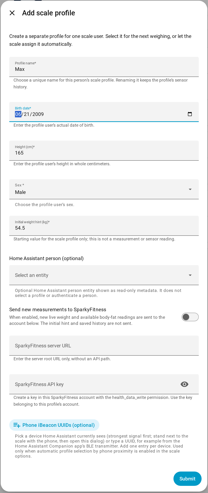

*Les champs du profil tels qu’affichés par **Ajouter un profil** (interface en anglais). Le premier formulaire de configuration contient les mêmes champs, plus l’adresse MAC et les options de connexion. La date de naissance suit le format de date de votre navigateur.*

Validez le formulaire une seule fois. Fermez Huawei Health, montez pieds nus sur la balance et restez immobile jusqu’à la fin de la pesée. Les capteurs ne reçoivent des valeurs qu’après la réception d’une mesure réelle par Home Assistant ; le poids initial indicatif ne les alimente pas.

## Ajouter et choisir des profils

Ouvrez la page de l’intégration Huawei AH100 dans **Paramètres → Appareils et services**, puis sélectionnez **Ajouter un profil** pour créer un autre profil. Vous pouvez modifier ou renommer un profil depuis la même page. Chaque nom doit être unique. Renommer un profil conserve l’identité de ses capteurs et leur historique.

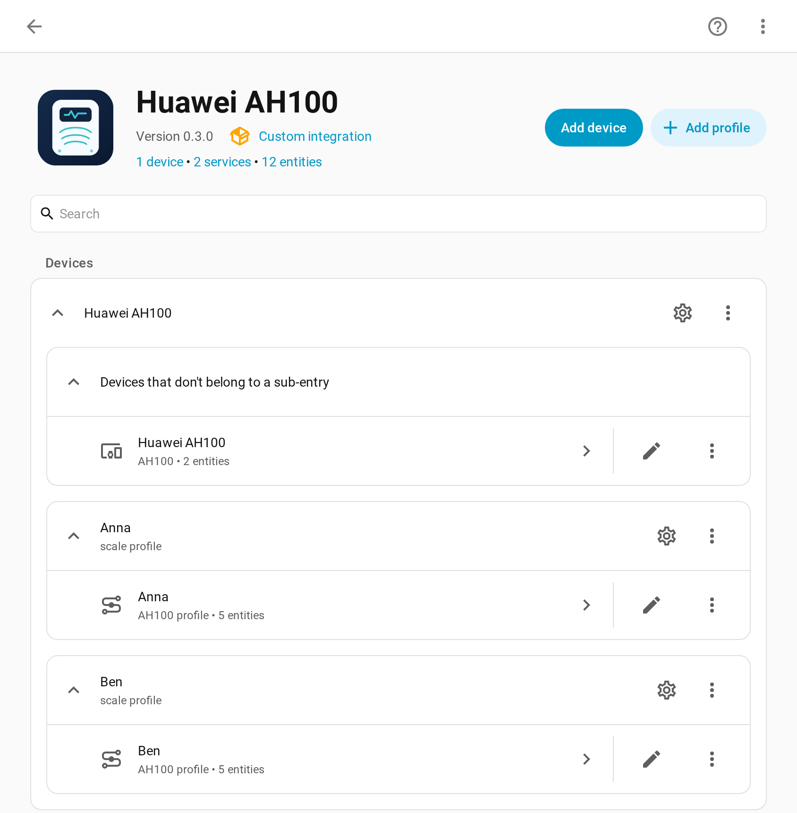

*La page de l’intégration : un appareil pour la balance et un par profil. **Ajouter un profil** crée un autre profil ; l’icône d’engrenage d’un profil permet de le modifier.*

Chaque profil possède ses propres mesures et son propre appareil Home Assistant, lié à la balance physique. Après la mise à jour depuis l’ancienne configuration à profil unique, elle devient **Profile 1** et conserve ses identifiants de capteurs, ses mesures et leur historique.

L’**Identifiant utilisateur de la balance**, l’option **Autoriser l’association** et l’option facultative **Confirmer le profil à chaque pesée** sont des réglages de connexion partagés par tous les profils et se trouvent dans les options de l’intégration. Cet identifiant est l’emplacement de la balance utilisé pour l’authentification Bluetooth, pas l’identifiant du profil. Sélectionner un profil ne modifie pas ce réglage et ne réassocie pas la balance. Si une session est en cours, Home Assistant la laisse se terminer et associe son résultat au profil d’origine avant d’utiliser le nouveau profil pour la prochaine session.

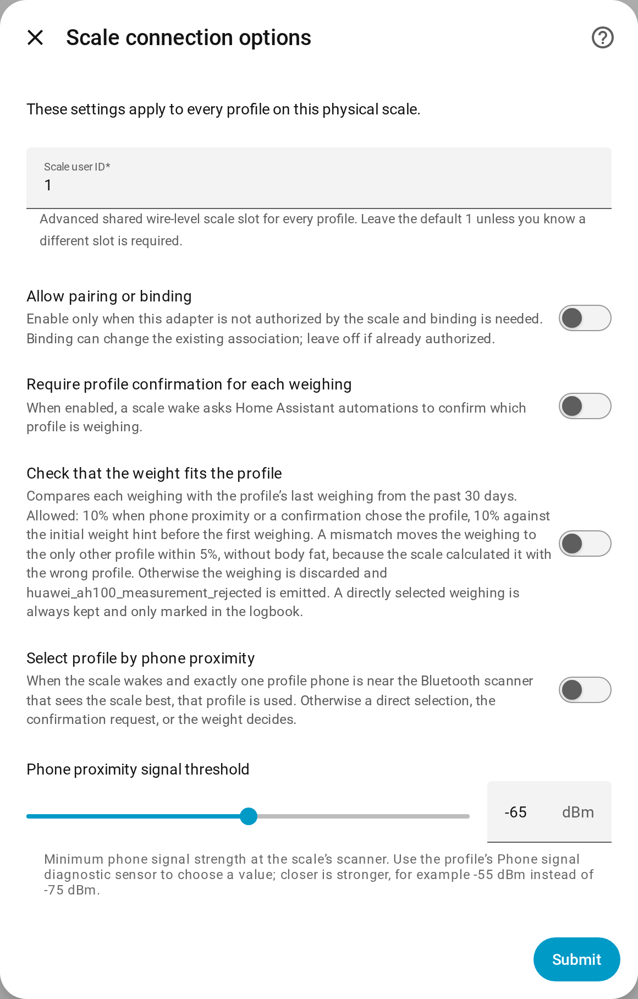

*Les options de connexion de la balance, ouvertes avec l’icône d’engrenage de la balance.*

## Attribution du profil

L’intégration détermine le profil de chaque pesée dans cet ordre :

1. **Sélection directe :** choisissez la personne dans le sélecteur **Profil pour la prochaine pesée** de la balance. La sélection ne vaut que pour la prochaine pesée enregistrée ; ensuite le sélecteur revient sur **Automatique**. La sélection n’est pas conservée après un redémarrage.
2. **Confirmation du profil**, si elle est activée (voir ci-dessous).
3. **Proximité du téléphone**, si elle est activée (voir [Choix automatique du profil selon la proximité du téléphone](#choix-automatique-du-profil-selon-la-proximité-du-téléphone)).
4. **Poids :** avec **Automatique** et sans téléphone proche, la pesée est attribuée au seul profil dont la dernière pesée, ou le poids initial indicatif avant la première pesée, est à moins de 5 % (10 % pour le poids indicatif). Si deux profils ou plus correspondent, ou aucun, la pesée est ignorée et `huawei_ah100_measurement_rejected` est émis avec `reason` `ambiguous_weight` ou `no_matching_profile` et les profils correspondants dans `candidates`. La balance calcule la masse grasse avec le profil pour lequel elle a été configurée, celui de la dernière personne pesée ; la masse grasse est donc supprimée si la pesée revient à quelqu’un d’autre. Avec un seul profil, chaque pesée lui est attribuée.

Chaque activation et désactivation est journalisée. Le capteur **Profil attribué** indique le profil actif pour la prochaine pesée, ou **Automatique**, avec les attributs `method` (`selection`, `confirmation` ou `proximity`) et `activated_at` ; son historique montre quand chaque profil était actif. Les événements `huawei_ah100_profile_activated` et `huawei_ah100_profile_deactivated` contiennent `entry_id`, `profile_id`, `profile_name`, `method`, `person_entity_id` facultatif et, pour la désactivation, une `reason` : `weighing_saved`, `replaced`, `deselected`, `out_of_range`, `multiple_phones_nearby` ou le motif d’annulation d’une confirmation. Le journal de bord liste ces événements avec les pesées enregistrées et leur mode d’attribution (`assigned_by` dans `huawei_ah100_measurement_saved`), ainsi que les pesées ignorées et leur motif.

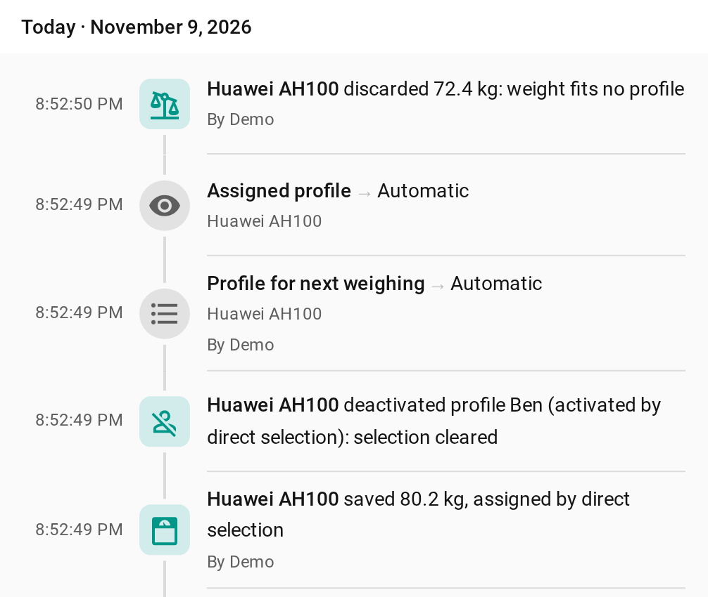

*Entrées du journal de bord : un profil sélectionné directement, la pesée enregistrée pour lui, la fin de la sélection et une pesée qui ne correspondait à aucun profil.*

## Automatisations de foyer facultatives

Sans cette option, le profil provient du sélecteur, d’un téléphone proche ou du poids. Pour demander aux automatisations Home Assistant de confirmer le profil à chaque pesée, activez **Confirmer le profil à chaque pesée** dans les options de l’intégration de la balance. Cette option n’apparaît pas dans la configuration initiale.

Lorsque l’option est activée, le réveil de la balance émet l’événement `huawei_ah100_weighing_requested` avec l’`entry_id` de la balance, un `request_id`, une heure d’expiration `expires_at` et les profils configurés (`profile_id`, `name` et, s’il existe, `person_entity_id`). L’intégration ne détermine pas qui est présent au domicile et n’envoie pas de notifications ; créez vos propres automatisations Home Assistant. Elles peuvent confirmer automatiquement lorsqu’une seule personne admissible est identifiée par la logique du foyer, ou envoyer des notifications avec action lorsque plusieurs personnes peuvent se peser. Pour une notification avec action, transmettez le `trigger.event.context.user_id` de l’événement d’origine dans `claimant_user_id` ; utilisez ce contexte et non une valeur d’identité fournie dans les données de l’action.

Une automatisation confirme un profil avec `huawei_ah100.claim_weighing`, en transmettant l’`entry_id` et le `request_id` de l’événement ainsi que le `profile_id` choisi. Le champ facultatif `claimant_user_id` indique l’utilisateur Home Assistant authentifié qui a appuyé sur l’action d’une notification ; laissez-le vide pour une sélection automatique fiable. La première confirmation valide est retenue. Une demande est refusée après son expiration, lorsque la balance s’endort ou se déconnecte, ou lorsque Home Assistant est rechargé. Une fois confirmé, le profil reste associé à cette mesure, car la balance utilise ses données démographiques pour calculer la masse grasse. Si la balance s’est déjà rendormie, réveillez-la à nouveau, confirmez la nouvelle demande, puis pesez-vous.

Après une confirmation, l’intégration émet `huawei_ah100_profile_confirmed`. Elle émet `huawei_ah100_weighing_cancelled` si une demande se termine sans mesure ; cet événement contient un `reason`. Quand une mesure est enregistrée durablement en local, `huawei_ah100_measurement_saved` est émis avec son `measurement_id` ; il peut déclencher un retour immédiat, par exemple un voyant vert. `huawei_ah100_measurement_completed` est émis pour cette même mesure durable après la réussite de SparkyFitness ou si la synchronisation est désactivée ; son `sync_status` vaut `synced` ou `disabled`. Utilisez l’événement terminé pour envoyer une notification finale du résultat à la personne concernée. Les champs d’événement et le cycle de vie des demandes sont détaillés dans les [notes de protocole](protocol.md).

## Choix automatique du profil selon la proximité du téléphone

Si chaque membre du foyer porte un téléphone qui diffuse un iBeacon, la balance peut choisir le profil seule. L’application Home Assistant Companion pour Android le permet avec son capteur **Émetteur BLE** ; toute autre source iBeacon convient aussi. L’adresse Bluetooth du téléphone peut changer, c’est pourquoi l’intégration identifie les téléphones uniquement par leur UUID iBeacon.

1. Sur chaque téléphone, activez l’émetteur iBeacon.
2. Placez-vous près de la balance avec le téléphone, modifiez le profil et choisissez l’appareil dans **UUID iBeacon des téléphones**. La liste affiche les iBeacons que Home Assistant voit actuellement, signal le plus fort en premier, avec le scanner qui les reçoit. Elle est remplie à l’ouverture de la boîte de dialogue ; rouvrez-la pour l’actualiser. Vous pouvez aussi saisir un UUID, une entrée par appareil. Un profil peut avoir plusieurs UUID, par exemple un téléphone et une balise, mais chaque UUID ne peut appartenir qu’à un seul profil.
3. Activez le capteur de diagnostic **Signal du téléphone** du profil, désactivé par défaut. Il indique le signal le plus fort des appareils de ce profil au scanner Bluetooth qui capte le mieux la balance, par exemple un proxy Bluetooth ESPHome dans la salle de bain. Les mesures de plus de 10 secondes sont ignorées.
4. Placez-vous sur la balance avec le téléphone là où vous le portez d’habitude et notez la valeur. Notez ensuite la valeur depuis l’endroit où se trouvent habituellement les autres personnes, par exemple la pièce voisine.
5. Dans les options de l’intégration de la balance, activez **Choisir le profil selon la proximité du téléphone** et réglez **Seuil de signal pour la proximité du téléphone** entre ces deux valeurs. La valeur par défaut est -65 dBm.

Tant qu’exactement un téléphone de profil atteint au moins le seuil à ce scanner, ce profil est activé et une pesée l’utilise, sauf si un profil a été sélectionné directement. L’intégration vérifie toutes les 5 secondes et journalise l’arrivée et le départ du téléphone. Avec **Confirmer le profil à chaque pesée**, l’intégration confirme elle-même le profil : elle n’émet pas `huawei_ah100_weighing_requested` et émet `huawei_ah100_profile_confirmed` avec `source: proximity` ; une sélection directe est confirmée de la même façon avec `source: selection`. Plusieurs appareils d’un même profil comptent pour un seul. Si les téléphones de deux profils ou plus sont proches en même temps, la proximité ne choisit pas : `huawei_ah100_multiple_phones_nearby` est émis avec `profile_ids` et `profile_names`, un profil activé par proximité est désactivé avec le motif `multiple_phones_nearby` et la pesée est attribuée selon le poids. Si cette pesée est ensuite ignorée, `huawei_ah100_measurement_rejected` liste aussi ces profils dans `nearby_profiles`. Si aucun téléphone n’est proche, la pesée est également attribuée selon le poids. Les UUID des téléphones et les mesures de signal restent dans Home Assistant et ne sont jamais envoyés à SparkyFitness.

## Contrôle de plausibilité du poids

Activez **Vérifier que le poids correspond au profil** dans les options de l’intégration de la balance pour repérer les pesées enregistrées pour la mauvaise personne. Cela concerne les pesées dont le profil a été confirmé ou trouvé par proximité du téléphone ; les pesées attribuées selon le poids sont toujours contrôlées comme décrit dans [Attribution du profil](#attribution-du-profil). Chaque pesée est comparée à la dernière pesée du profil datant de moins de 30 jours :

- un écart jusqu’à 10 % est accepté ;
- avant la première pesée d’un profil, son poids initial indicatif sert de référence avec 10 % ;
- si la dernière pesée date de plus de 30 jours, la pesée est acceptée sans contrôle, afin qu’une longue pause ou un régime ne fasse pas perdre de données.

Si une pesée ne correspond pas, elle est attribuée au seul autre profil à moins de 5 %. La balance a calculé la masse grasse avec la taille, l’âge et le sexe du mauvais profil ; une pesée déplacée conserve donc le poids et l’impédance, mais pas la masse grasse, et `huawei_ah100_measurement_saved` contient alors `redirected_from`. Si aucun autre profil ou plusieurs profils correspondent, la pesée est ignorée et `huawei_ah100_measurement_rejected` est émis avec `entry_id`, `profile_id`, `reason` `weight_mismatch`, `weight_kg`, `reference_weight_kg` et `impedance_ohm`. Le contrôle ne peut pas distinguer des personnes dont les poids diffèrent de moins de 5 %.

Une pesée sélectionnée directement n’est jamais déplacée ni ignorée : un vrai changement de poids ou une ancienne pesée erronée ne peut donc pas bloquer un profil. Si elle échoue au contrôle, elle est tout de même enregistrée et `huawei_ah100_measurement_saved` contient `weight_check_overridden: true`, ce que le journal de bord affiche.

## Synchronisation SparkyFitness

La synchronisation SparkyFitness est facultative et se configure séparément dans chaque profil :

1. Activez **Synchronisation SparkyFitness** dans le profil.
2. Saisissez l’URL racine du serveur, par exemple `https://fitness.example.com` ; n’ajoutez pas de chemin d’API.
3. Dans le compte SparkyFitness correspondant, créez une clé API avec la permission `health_data_write`, puis saisissez-la. Chaque profil doit utiliser la clé de son propre compte ; ne réutilisez pas une clé globale partagée entre profils.

Lors d’une modification ultérieure du profil, laissez le champ de clé API vide pour conserver la clé enregistrée ; Home Assistant ne la préremplit pas.

L’intégration envoie uniquement les nouvelles pesées réelles : le poids en kilogrammes et le pourcentage de masse grasse lorsqu’il est disponible. Elle n’envoie ni le poids initial indicatif, ni l’historique, ni les champs du profil, ni l’impédance. Elle effectue une requête `POST` vers `/api/measurements/health-data`, une route présente dans [SparkyFitness v0.17.3](https://github.com/CodeWithCJ/SparkyFitness/blob/2a7e0d8f317fff14fc6596d573df0c2ae6ba6f9d/SparkyFitnessServer/routes/measurementRoutes.ts). SparkyFitness stocke une entrée de mesure quotidienne par compte ; une nouvelle pesée le même jour met à jour les valeurs de cette journée. La requête contient une date sans heure, correspondant au jour local de Home Assistant : le fuseau horaire du compte SparkyFitness doit donc correspondre à celui de Home Assistant. L’heure exacte et l’impédance restent disponibles dans Home Assistant.

Le capteur **Synchronisation SparkyFitness** indique « désactivée », « en attente », « synchronisée » ou « erreur ». Un profil configuré peut afficher « en attente » avant sa première synchronisation confirmée. Si le serveur est inaccessible, la mesure reste en file d’attente et l’envoi sera réessayé. Un changement d’URL ou de clé ne redirige pas une mesure en attente vers un autre compte. La configuration ne crée pas de fausse mesure de test et n’envoie pas l’historique.

## Cartes de tableau de bord

L’intégration fournit deux cartes de tableau de bord. Elles se chargent automatiquement, sans ressource à déclarer ni téléchargement séparé. Modifiez un tableau de bord, choisissez **Ajouter une carte** et recherchez **Huawei AH100**. Après une mise à jour, rechargez une fois la page du navigateur.

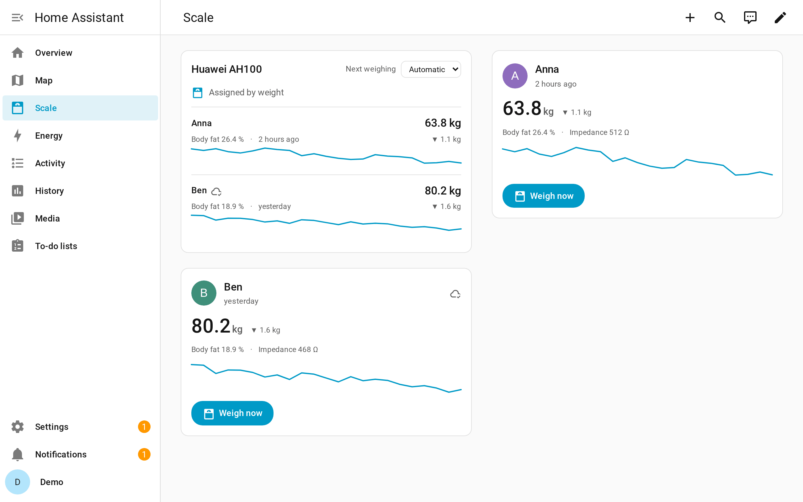

*Exemple de tableau de bord avec des données de démonstration : la carte de la balance et une carte de profil par personne.*

- **Balance Huawei AH100** (`custom:huawei-ah100-card`) : tous les profils d’une balance avec le dernier poids, la masse grasse, l’heure de la dernière pesée, l’état SparkyFitness et une tendance sur 30 jours issue des moyennes journalières. Une liste déroulante choisit le profil de la prochaine pesée, une ligne indique quel profil est actif et comment, et une pesée ignorée au cours des dernières 24 heures est affichée avec son motif. Sélectionnez un profil pour ouvrir l’historique de son poids.
- **Profil Huawei AH100** (`custom:huawei-ah100-profile-card`) : un profil avec la photo de la personne, le poids, la tendance, la masse grasse et l’impédance, ainsi qu’un bouton **Peser maintenant**. Le bouton sélectionne ce profil pour la prochaine pesée ; la carte invite alors à monter sur la balance et propose **Annuler**. Si la proximité du téléphone ou une confirmation a activé le profil, la carte l’indique.

| Carte de la balance | Profil sélectionné | Pesée ignorée |
| --- | --- | --- |
| 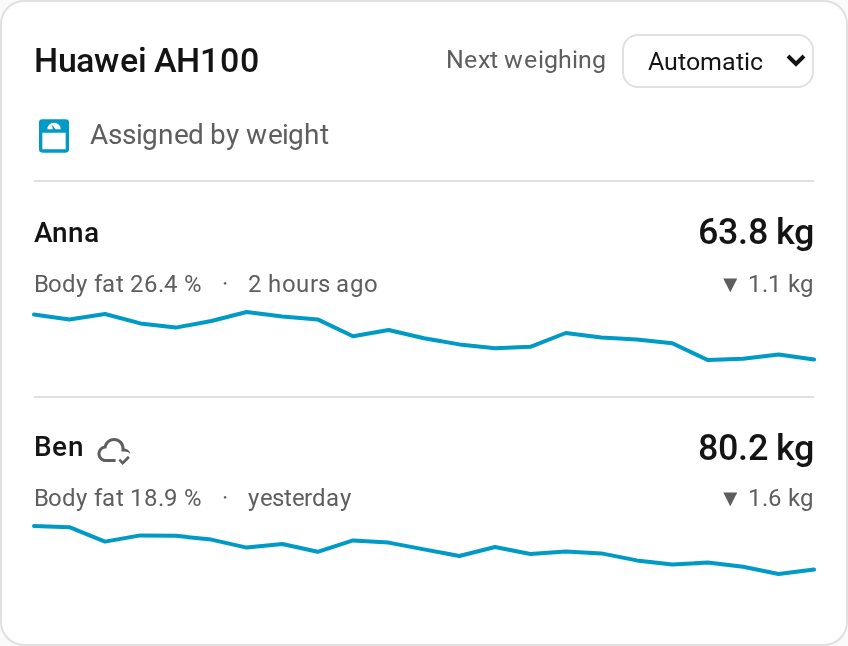 | 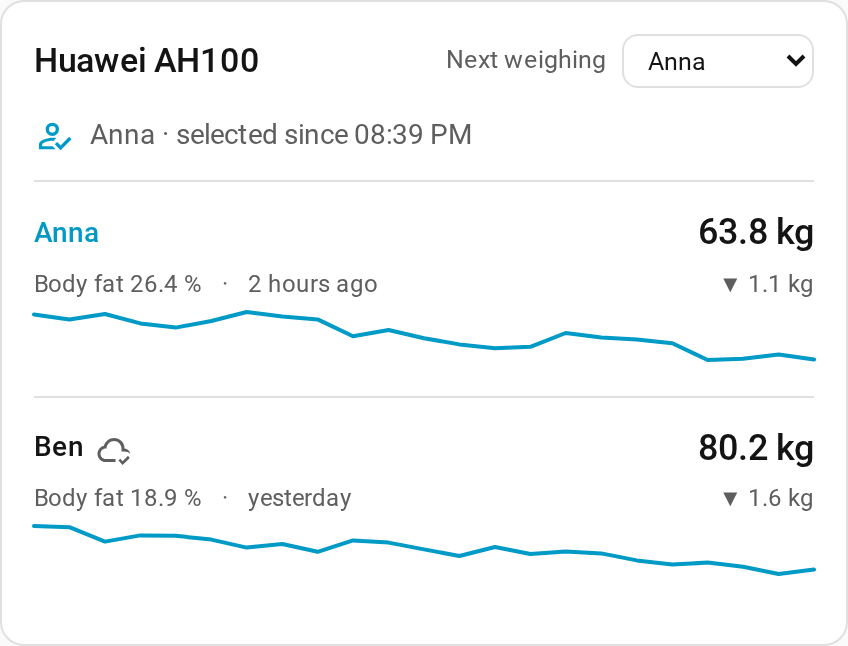 | 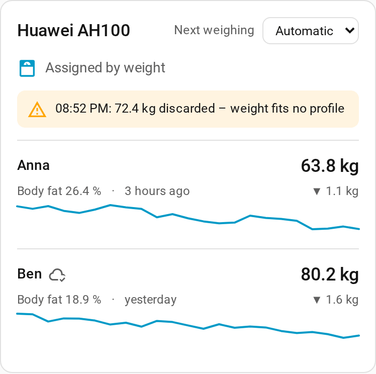 |

| Carte de profil | Après **Peser maintenant** |
| --- | --- |
| 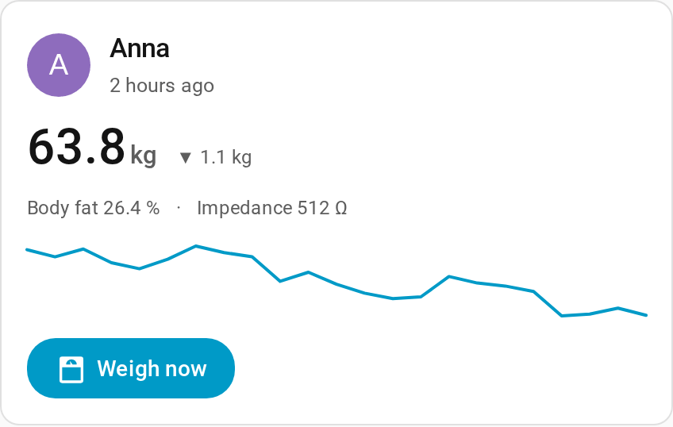 | 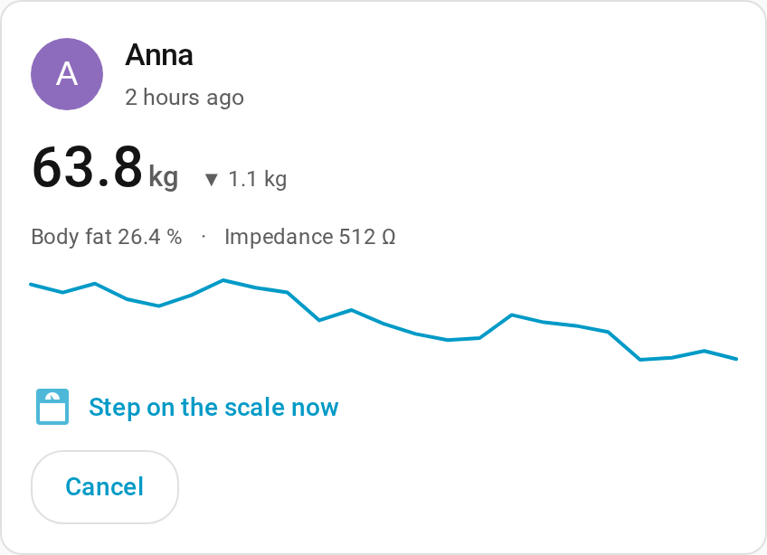 |

```yaml
type: custom:huawei-ah100-card
device_id: <appareil balance>
---
type: custom:huawei-ah100-profile-card
device_id: <appareil profil>
```

Les deux cartes acceptent un `title` facultatif. Elles suivent le thème du tableau de bord et s’affichent en anglais, allemand ou français selon la langue de Home Assistant. La tendance repose sur les statistiques à long terme ; elle apparaît après le premier jour avec des pesées.

## Dépannage

- **La liste des appareils proches est vide ou sans nom :** fermez Huawei Health, réveillez la balance et relancez la recherche à portée Bluetooth. Vérifiez que l’adaptateur Bluetooth de Home Assistant est en mode **Automatique** ou **Actif** pour récupérer le nom annoncé. Avec un adaptateur uniquement passif, utilisez **Configuration manuelle** et saisissez l’adresse MAC.
- **Les capteurs sont indisponibles :** choisissez la personne dans **Profil pour la prochaine pesée**, puis effectuez une pesée pieds nus et restez immobile jusqu’à la fin. Les capteurs ont besoin d’une mesure réelle pour recevoir leurs valeurs.
- **L’authentification est refusée :** si cet adaptateur n’a pas été autorisé par la balance, activez **Autoriser l’association** dans les options de connexion de l’intégration, puis réveillez à nouveau la balance. L’association peut modifier celle déjà enregistrée ; n’activez cette option qu’en cas de besoin.
- **Un téléphone est connecté ou Home Assistant ne parvient pas à se connecter :** fermez Huawei Health, déconnectez les autres téléphones ou clients de la balance, puis vérifiez l’adresse MAC sélectionnée ou saisie.
- **La synchronisation SparkyFitness reste en attente ou affiche une erreur :** vérifiez l’accès au serveur, l’URL du profil et que sa clé API appartient au bon compte et possède la permission `health_data_write`. Vérifiez aussi que le compte et Home Assistant utilisent le même fuseau horaire.

## Confidentialité et traitement des données

La communication Bluetooth avec la balance est locale. Aucune mesure ni valeur de profil n’est envoyée vers un service cloud tant que la synchronisation SparkyFitness n’est pas activée pour un profil. Si elle est activée, seules les nouvelles valeurs de poids, la masse grasse disponible et la date locale Home Assistant sont envoyées au serveur SparkyFitness configuré pour ce profil. La date de naissance, la taille, le sexe, l’entité Personne, l’heure exacte de pesée et l’impédance ne sont pas envoyés à SparkyFitness.

La dernière mesure réelle acceptée est enregistrée dans le stockage privé de l’intégration Home Assistant afin de restaurer les entités et de réutiliser le poids mesuré comme prochaine indication de profil. L’enregistrement décodé complet n’est pas publié dans les états ou attributs des capteurs ; leurs attributs exposent uniquement les métadonnées de mesure documentées.

Ne publiez pas l’adresse MAC de votre balance, vos dates de naissance, valeurs de profil, clés API ni des captures Bluetooth non expurgées. Pour signaler un problème, indiquez le modèle et le firmware de la balance ainsi que la version de Home Assistant, sans identifiant personnel.

## Contribution

Consultez [CONTRIBUTING.md](../CONTRIBUTING.md) pour l’environnement de développement, les tests et les contrôles de style. Les notes de protocole et les limites de validation sont dans [protocol.md](protocol.md).

## Licence et attribution

Ce projet est distribué sous licence **GPL-3.0-or-later**. L’implémentation du protocole est un portage Kotlin vers Python basé sur [`HuaweiAhCh100Handler.kt`](https://github.com/oliexdev/openScale/blob/39a0c5c25a0abc26b8e24c90f36b5a2c6ff07a4a/android_app/app/src/main/java/com/health/openscale/core/bluetooth/scales/HuaweiAhCh100Handler.kt) du projet openScale, au commit [`39a0c5c25a0abc26b8e24c90f36b5a2c6ff07a4a`](https://github.com/oliexdev/openScale/commit/39a0c5c25a0abc26b8e24c90f36b5a2c6ff07a4a). Consultez [protocol.md](protocol.md) pour le périmètre du protocole et les détails d’attribution.
